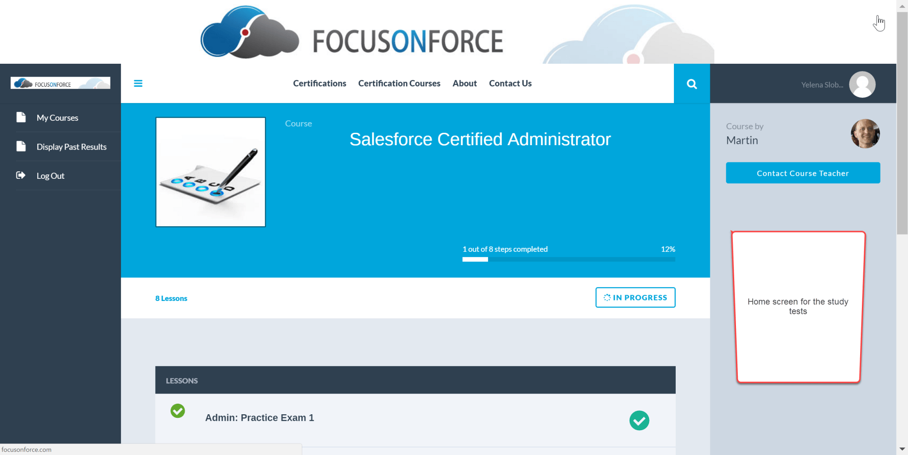
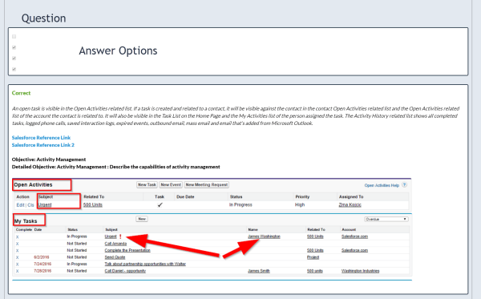

Leading up to my exam, I knew I would need to some practice tests and I knew just where to go! The site focusonforce.com had been recommended left and right as the place to get exams that would mimic the real thing.<!--more-->

I initially used focusonforce for their [free 50 question quiz](http://focusonforce.com/salesforce-adm-201-exam-questions/), which provides real-time results that are easily understandable.  I took this as a pre-exam, before I had even completed the [201 course from Salesforce](https://www.salesforce.com/assets/pdf/datasheets/DS_ADM201.pdf) or finished working through [Trailhead](http://trailhead.salesforce.com), and didn't do very well. However, I was more than OK with that as it ended up being a great indicator of both the types of questions to expect and the level of detail on the topics I was going to need to know.

I ended up purchasing their [6 pack of exams](http://focusonforce.com/courses/salesforce-certified-administrator/) for $19, and I have to say this has to be the best $19 spent for any exam I have ever taken in my academic or career life.

\[caption id="attachment\_104" align="alignnone" width="1024"\] Screenshot of the home screen for the course\[/caption\]

Each exam is comprised of 60 questions and the test can be completed in either a timed setting and you see your results at the end, or you have the option to go through the test question by question, and see the results as you go through it.

One of the reasons I really appreciated having these practice tests was the comprehensive job that was done on the results page. Most answers (correct and incorrect) included detailed screenshots of where things are in Salesforce and the steps to follow to answer the question.

\[caption id="attachment\_110" align="alignright" width="300"\] Screenshot of the answer page\[/caption\]

In addition, every question came with a detailed description about the correct answer and included at least one Salesforce reference that linked to the documentation page.

The only thing that I found less favorable was that it seemed some of the practice tests were overly weighted towards some of the topics that have very low percentage points based on the information provided by the Salesforce study guide.

The last thing I found really useful about this package was the Questions by Topic section, which I was able to use in the days leading up to my exam in order to pinpoint specific weak points and to just focus my time and energy in those areas.

**Overall, I would rate this site and the exams with an A-.** Keep an eye out for my next post on Salesforce Admin course :)

\[gallery ids="117,110,104" type="square"\]
