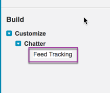
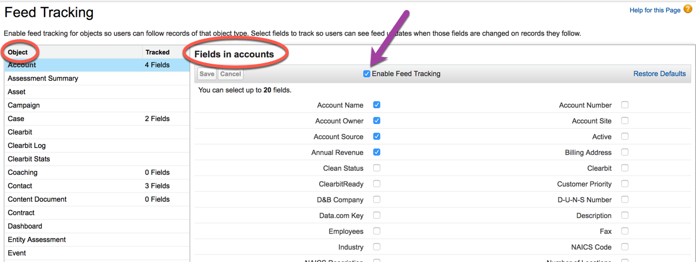
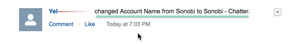

By now everyone is probably using the History Tracking feature that comes on both standard and customs objects (if you aren’t, [jump down](#History_Tracking) to the bottom of the page to get a quick how-to). This feature is awesome for being able to run reports, although there are [some ideas](https://success.salesforce.com/ideaview?id=08730000000BrlxAAC) for improvements.

While this is a great feature, Salesforce caps you at 20 fields per object, so I found a workaround. If you have already enabled Chatter in your organization, then I am sure you have heard about Feed Tracking. And if you haven’t, well you're in luck, as I am going to give a quick breakdown of why I like the feature as much as History Tracking.<!--more-->

Feed Tracking can be found by going to Setup -> Chatter -> Feed Tracking, or if you are lazy like me, just type Feed Tracking in the search bar in Setup.

Once there you will see something similar to how History Tracking looks. You select the object you want on the left, turn on the Enable Feed Tracking and then the fields you want to track on the right. Of course, sadly, Salesforce also caps this at 20 fields, but if you are smart about it, you can get a **total of 40 fields** between these two tracking options!

Now once you have your fields picked, the magic begins. On any object that you have added the tracking to, you can see the changes your user makes either right at the top of the screen or on the feed tab (based on if you have the page layout set to be Feed-Based). The reason I think this is magic, is when a user comes to me and says how did the Account Name get changed or why is the Status of my Account different than it was this morning, all I need to do is look at the feed on that Account and I will see the who, what, and when of the change, and bam question solved.

The one downfall to Chatter Feed tracking (this is where History Tracking wins) is its reporting capabilities. While, Salesforce says the [Idea](https://success.salesforce.com/ideaView?id=08730000000YfNMAA0) that they completed in Summer ‘15 solved this issue, in reality, it didn’t. You cannot report on updates to an object. You can only view the changes at the object or user level. If you know ahead of time you will need reporting, then that is a good field to use with History Tracking.

Keep an eye for my next tips & tricks post about adding a display message to your page layout :)

How to set up [History Tracking](https://help.salesforce.com/articleView?id=tracking_field_history_for_standard_objects.htm&language=en_US&type=0)

1. Go to Setup and to the Object you want to track
2. Go to the fields section of the Object
3. Click the Set History Tracking
4. Click the check boxes next to each field you want to be tracked - remember only 20 allowed per object
5. Click Save and you are all set!

One last thing, if you want to see the changes right from the object, make sure to add the History tracking related table.

\[gallery ids="170,171,153,154,155" type="rectangular"\]
