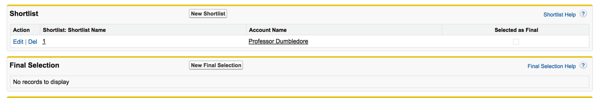
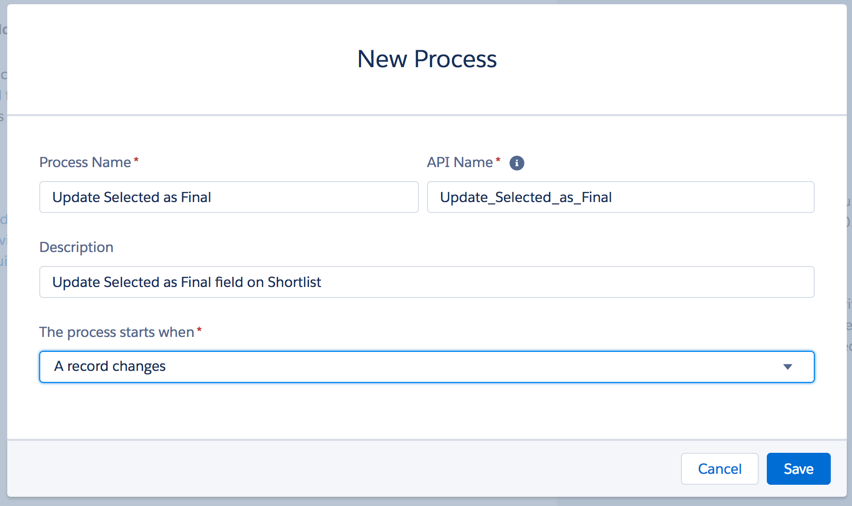
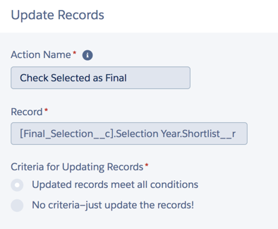
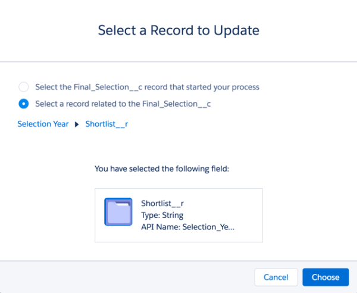
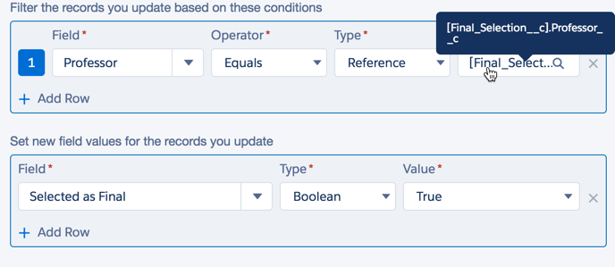
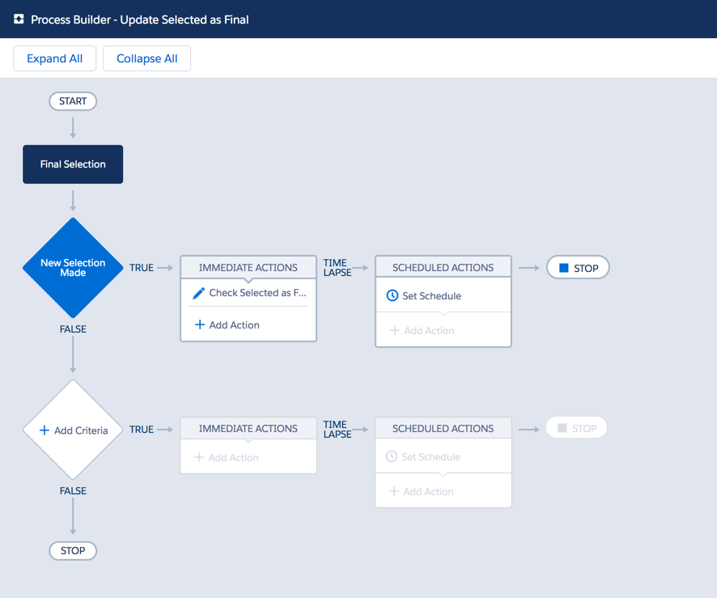
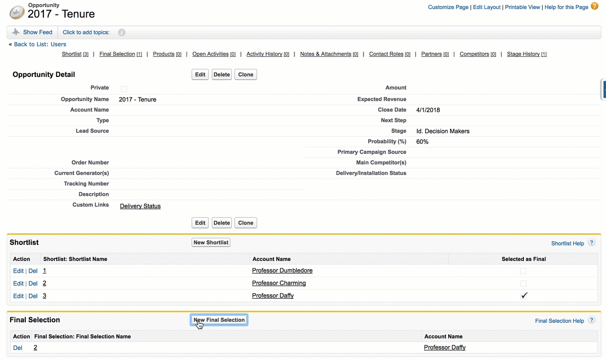

Say you have a university who is tracking the possible professors up for tenure. They have a Shortlist (object 1) and their Final Selection list (object 2). Both lists are maintained on an annual basis (1 year = 1 opportunity). The university likes to be able to look back at the shortlist to quickly see who was selected from it.

The question to solve is how do you quickly and automatically see this?

To solve this use case I used a checkbox field on the Shortlist that is automatically marked as TRUE when a professor from that list is added to the Final Selection list. This automation happens via the Process Builder.

Below you will find the steps I took using the Process Builder to make this happen. <!--more-->

First things first, you will need to create a checkbox field on _Shortlist_ called “**Selected as Final**”. Preferably you will make this field read-only to everyone that isn’t the admin.

The next steps are all going to take place within the **[Process Builder](https://developer.salesforce.com/page/Lightning_Process_Builder)**. To get there, go to Setup -> type in "Process Builder" in the search bar -> a new lightning page will launch with the Process Builder.

How to create the Process Flow:

1. Fill out the name and description of the business process.
2. Select your Primary Object. In our case, this will be _Final Selection__._ Select either **on record creation** or **record creation and edit** based on your use case.
3. Next, define criteria for when to start this process. In my use case I do not have any criteria so I will select just “**No criteria—just execute the actions!**” and give the criteria the name _New Selection Made_.
4. Now for the most important step:  filling out the Immediate Actions section
    1. Since we are updating a field, we will need to select **Update Record**
    2. Give the **Action Name** whatever you feel is accurate
    3. **Record type** will prompt you with another pop-up. You will want to select a related record, this way you have access to the _Shortlist_ object. 
    4. The criteria for updating the record will need to be setup to compare the Professor field on _Shortlist_ to the Professor on the _Final Selection_ list.
    5. Lastly, you will need to set what field to be updated and with which value. In our case, it is the **Selected as Final** field with a value of True.
5. Click **Save** and then **Activate** and you are all set!

Now, when you add a new Item to the _Final Selection_ object, the **"Selected as Final"** checkbox will auto-populate.

If you are interested in learning more about Process Builder make sure to check out the Trailhead project "[Quick Start: Lightning Process Builder](https://trailhead.salesforce.com/projects/quickstart-process-builder)".
