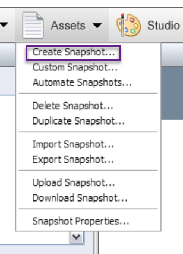
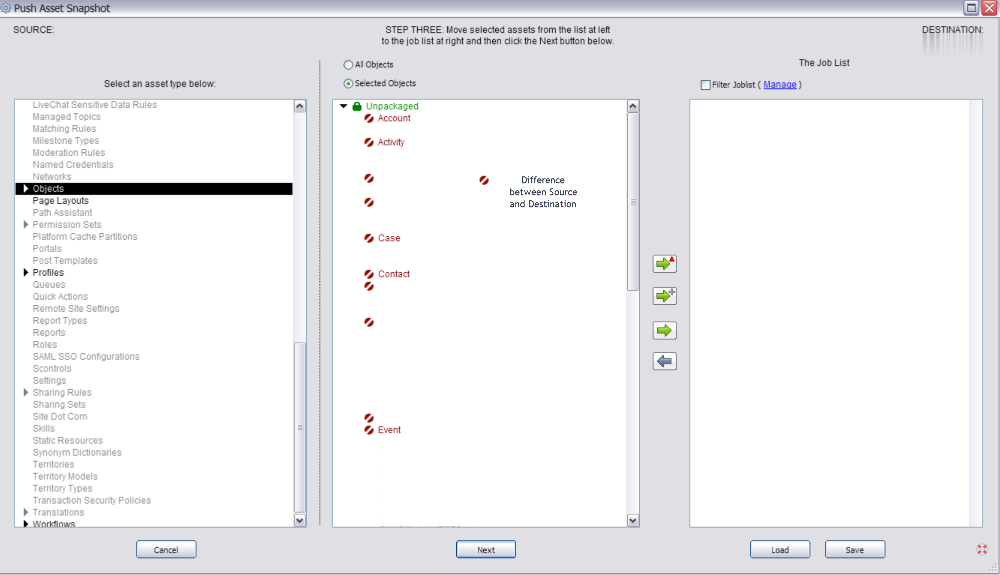

With many different sandboxes to keep organized, I needed a tool that could help me achieve the following goals:

- Make pushing change set easier (including push items Salesforce does not usually allow you to push)
- Be able to compare different orgs to see the differences
- Be able to run reports on fields to see which are in use and to what degree

I started doing research by looking through Stack Overflow and AppExchange to find a tool that would meet my needs.<!--more-->

I tested several before landing on and purchasing [SnapShot from dreamfactory](https://www.dreamfactory.com/force.com/snapshot). (The reviews on the products I tried will be coming in the next couple weeks). I chose SnapShot for several reasons. The first being that it met all of my needs. The second was that it's a desktop application instead of a cloud-based app (which I found to be too easy to screw up my production org).

Below is a bit of how SnapShot works:

Once logged into the product, you are on the home screen where you can see all of the snapshots you have taken - a snapshot is an XML copy of your org at the time you take it. When you select a snapshot on the left, in the middle you can then see the full XML.

Taking a snapshot is really simple. Switch to the right Salesforce account, if you aren't already in it, and then select "Create a Snapshot". You select the elements you want to capture and then you are all good to go!

Comparing snapshots it just as simple. In the top menu select Compare Assets, pick the two or more snapshots you want to compare and off you go!

Lastly, and my favorite part of the product is the ability to push change sets. The reason I like this part of the product is because when you set up the change set you can see the differences between the source org and the destination org. In my use-case, this is very useful as it allows me to easily see what I have changed or perhaps what I have forgotten that I changed. Additionally, when pushing a change set you have the ability to push even if there are errors and to do data transformations, like changing an email address for an email alert.

I have not had a chance to use the report functionality but I did get to see it in the demo and I know that when it comes to doing my spring org cleaning it will be very beneficial.

I have also had a great experience with the company itself and their technical support. The rep I have been working with tailored the initial training to meet my needs and my learning curve (we only needed to spend an hour together instead of the usual 2.5 hours). As well, any question I have had so far they have been quick to respond.

The only downfall I have found so far .... well I haven't found one yet. **Therefore, I would rate this product with an A+.**

Oh, one other really cool aspect of the product is SnapShots app from the AppExchange which maintains every change set that is pushed through success or failure and any errors.

The full documentation for Snapshot can be found [here](http://dreamfactory.pbworks.com/w/file/fetch/103116871/Snap_Shot_User-Guide%20November%2017%202015.pdf).

Keep an eye for my next post covering a review of Premier Plus Support from Salesforce.
