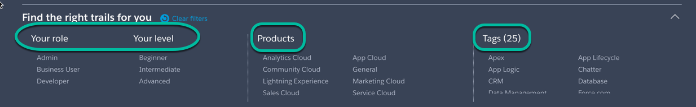
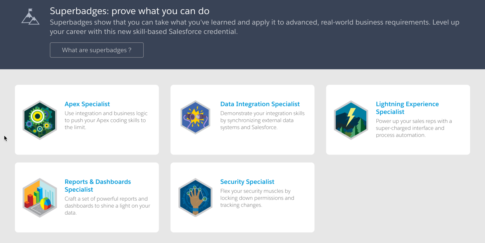

Salesforce Trailhead... where do I even begin?!

Out of all the self-help, self-study tools, I have used both during my academic career and professional career, Trailhead has to be at the top of my list of most useful resources for helping me learn something new.<!--more-->

Once I knew that I was going to take on the Admin role in my company, Salesforce's Trailhead was where I got started. The site has so many different paths and options to choose from depending on your goals. For me, since I already had significant experience as a user, I did not focus my efforts on their "business user" related modules, but rather I focused on the "admin" modules.

Now, before I go any further, let me give a brief description of the different options that Trailhead has to offer. First, it has three different methods for selecting a module; you can simply select the individual module you would like to complete, or you can decide on the trail you want to pursue (trails contain multiple modules related to a specific topic) or if you are looking for something more hands-on you can pick a project.

In all three options, you have the ability to use several different filtering methods. You can filter by your role (as I mentioned above I focused on Admin), you can filter by the Product from Salesforce you want to explore, or you can look through their list of more specific tags and filter based on those.

OK, so back to my story. I filtered based on Admin for role and Beginner for the level. In the Trails section, this gave me a lot of options to choose from. I initially went through the [Admin Beginner Trail](https://trailhead.salesforce.com/trails/force_com_admin_beginner) as I had read this was a good place to start my training.

Anyway, the reason I found this to be so useful was because of how well laid-out everything is and the hands-on activities. During each module, there would be descriptions and step-by-step instructions for how to do certain things and when to do them, and also why. When you finish a module, there is an activity. Activities can be quizzes or hands-on projects that need to be completed in a developer org. Make sure to get yourself a FREE developer account to utilize Trailhead to its full advantage. You will be able to connect it to the Trailhead site and then you will be able to do all the activities and earn awesome badges along the way!

Lastly, I want to call out the Superbadges. These things are great if you want to really do a deep-dive into one of their topics. I have already completed the Security badge and am in the middle of the Reports and Dashboards badge. After I completed the Security badge, which includes a several hours multi-step project, I felt like I had a really good understanding of how Salesforce sees its users utilizing the properties.

Overall, I really found this method of learning to be immersive and well-rounded. I felt like I was actually able to get all the material I needed on a particular topic out of Trailhead. I highly recommend this for anyone at any stage in the game as it has something for everyone.

**As a result, I would rate this platform a B+.**

If you would like to know why they don't receive an A+ in my book, please check out my post on [Training your employees using Trailhead](http://sf9to5.wordpress.com/2017/02/23/using-trailhead-to-train-your-employees/).
