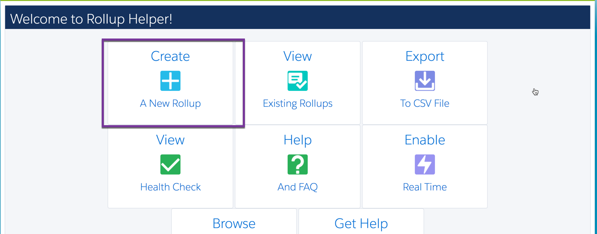
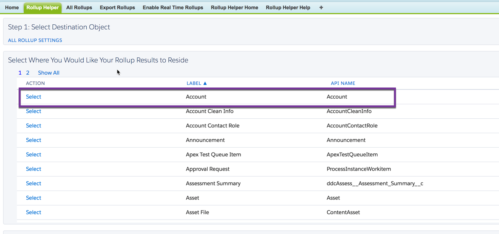
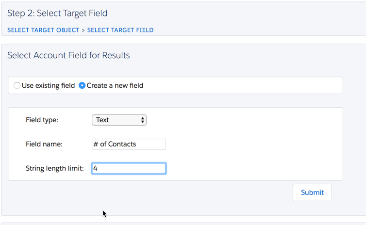
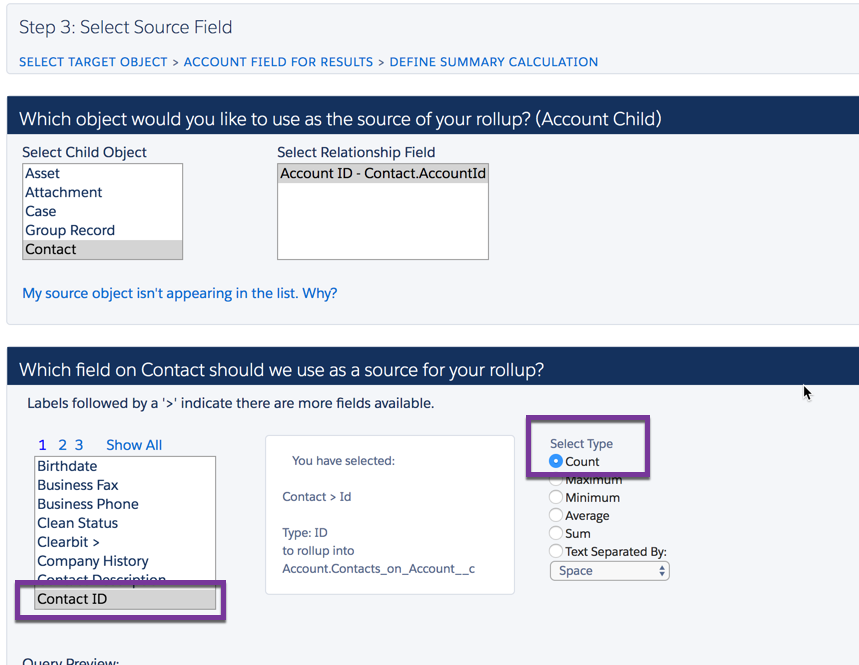
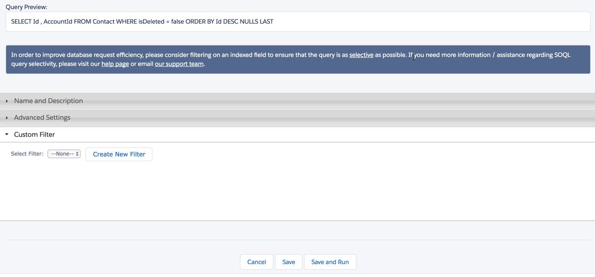
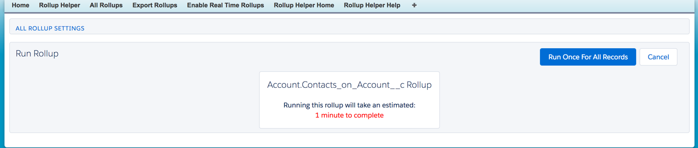
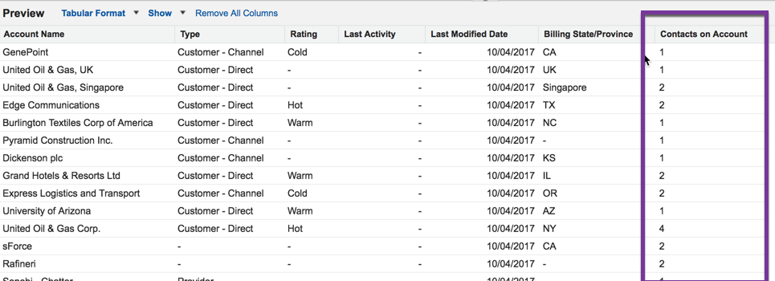
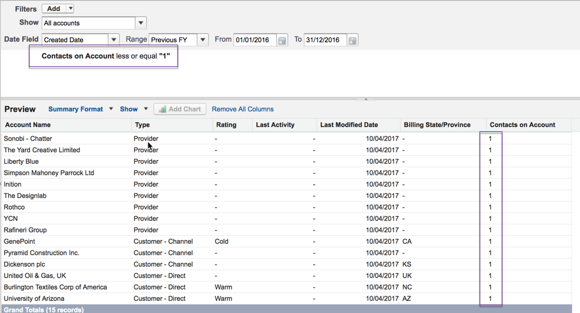

We have all run into this issue... the desire to know how many Accounts have "x" number of Contacts associated to them. Whether it's for Lead generation or just a desire to know, Salesforce has done a good job of being able to easily obtain this information. Salesforce has a field called Rollup Summary, however, between Accounts and Contacts, Salesforce has prevented us from being able to do such a simple task. Well, [Rollup Helper](https://appexchange.salesforce.com/listingDetail?listingId=a0N30000009i3UpEAI) is here to help.

This is a tool one of my colleagues stumbled upon and I have found it to be really great. It allows you to do all sorts of different lookups and rollups. However, for the purpose of this blog, I am going to stick with explaining how to use it to see the number of Contacts per account and how to create a report to see which Accounts only have 1 Contact.

Here are the steps:

1. [Download & Install Rollup Helper from AppExchange](https://appexchange.salesforce.com/listingDetail?listingId=a0N30000009i3UpEAI)
2. From within the Rollup App, select the "Create New Rollup"
3. Select _Account_ for the Destination object
4. You can use an existing field or create a new field (I recommend using a text field for this) 
5. Click "Submit"
6. You will then need to select the field on which to "Count" (type) - use ContactID as it is a unique value that will exist for every Contact regardless of any other settings
7. Lastly, you have the option to add filters and some other customizations - I haven't touched any of these for this example 
8. Then click "Save and Run" and on the next screen "Run Once for All Records" - this will generate the values 

Great! Now you have a field that tells you how many unique Contacts per Account.

The next part of the issue is running the report.

I am going to use the standard Accounts report to do this example as I don't see the need for names. Of course, you have the flexibility to do this in any which way that works best for you.

Once you are in the report and have the fields you want, add in the field that you used or created above, in my case, it is "Contacts on Accounts".

As you can see above I have a field with numbers I can either bucket (say 1-3 and 4-6) or I can filter by (say Accounts with Contacts =< 1).

Now I can see exactly which accounts only have 1 contact.

P.S. If you would like Salesforce to allow Rollups for Contacts to Accounts please check out this Idea: [https://success.salesforce.com/ideaView?id=08730000000BpFHAA0](https://success.salesforce.com/ideaView?id=08730000000BpFHAA0) and [https://success.salesforce.com/ideaView?id=0873000000079UUAAY](https://success.salesforce.com/ideaView?id=0873000000079UUAAY)
