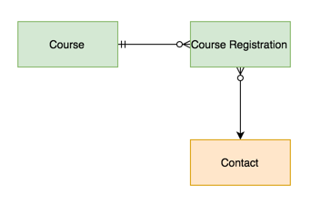
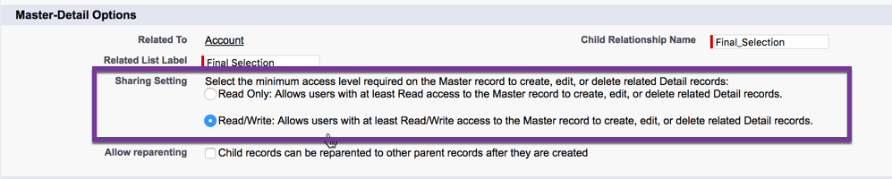

Let's say you have the following setup:

Object 1: Courses (custom)

Object 2: Course Registration (custom)

Object 3: Contacts (standard)

The Course Registration object is a [junction object](https://help.salesforce.com/articleView?id=relationships_manytomany.htm&type=0) between the Courses and Contacts objects to create a many-to-many relationship (depicted in the diagram below).

Your [organization-wide settings](https://help.salesforce.com/articleView?id=sharing_model_fields.htm&type=0) for Contacts and Courses is set to "Public Read-Only" and Course Registration is set to "Controlled by Parent". The question is how do you allow someone to create and edit on Course Registration (our junction object) who does not own either the Contact or the Course, without using Sharing Rules or Teams?

You can do this by answering one very important question on the [master-detail relationship](https://trailhead.salesforce.com/modules/data_modeling/units/object_relationships#Tdxn4tBK-heading8) fields within the custom object. There is a section called Master-Detail Options and looks like this:

Here you can set the Sharing Setting specifically for this object.

The "Read/Write" option means that your users need both read and write permissions on the Master object (in our business case either the Contact or Course object) to be able to create or edit on the custom object (the Course Registration object).

The "Read Only" option means that a user simply needs read-only access to the Master, so either Contact or Course and then they will have write access to the object. This option fulfills the original need.

And there you have it, another way to manage your sharing rules, directly on the object.
