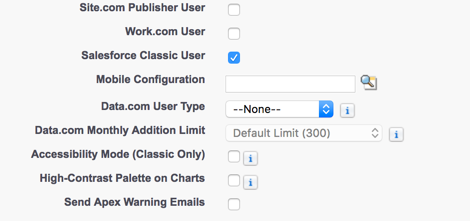
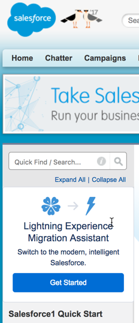
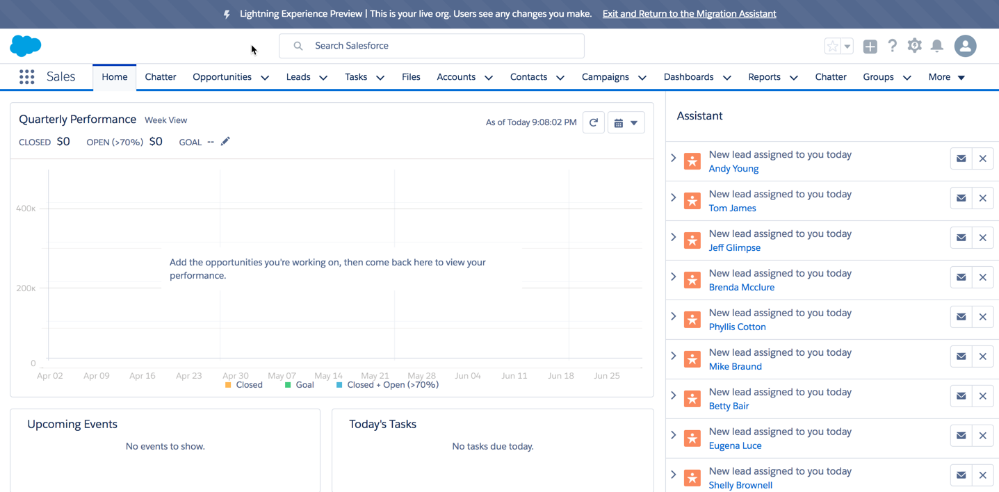
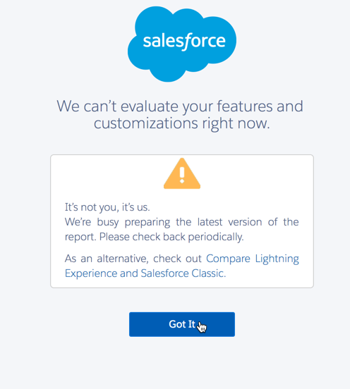

I recently got a preview org for the Summer '17 release and wanted to share some brief findings that I found interesting.

[Summer '17](https://resources.docs.salesforce.com/208/latest/en-us/sfdc/pdf/salesforce_summer17_release_notes.pdf) is the release I am deeming the drive towards lightning. While my company is nowhere near moving to Lightning, Salesforce as a company is definitely trying to tell us, Classic folks, soon enough you are going to have move. This can be readily seen in many of the changes that come with the new release.

Examples include:

An update to the User profile, where now instead of turning on Lightning for a User, you can now turn off Classic. 

A fully redesigned Salesforce Classic to Salesforce Lightning Migration tool.

This Migration Assistant tool features a cool Lightning Experience Preview, which allows you to experience how your org will look and feel and to see how changes you make will impact your users.

However, the Migration Assistant is not fully functioning yet. I wanted to try out the updated Readiness chart, but I keep getting this error:

Hopefully, once it is live I will be able to check it out. At least, according to the Compare Lighting Experience and Salesforce Classic chart, way more features are now available in Lightning than they were before and it is obvious Salesforce is choosing not to add as many new things to Classic, but rather add them just to Lightning.

Some other features that I thought are cool but completely unrelated to the Lightning, are:

The [Integrations Tool](http://resources.docs.salesforce.com/rel1/doc/en-us/static/pdf/ext-svc-overview.pdf) (which has disappeared since I last opened the preview Sandbox) is designed to help users integrate with 3rd party services.

Being able to add related records in Lighting and access field history-related lists.

A couple notes with Summer '17:

1. As is known with Salesforce, before even rolling out their next release there is a list of known issues, make sure to check it out: [https://success.salesforce.com/issues\_releases\_view?release=208000000](https://success.salesforce.com/issues_releases_view?release=208000000).
2. Make sure you are keeping your external integrations up-to-date security-wise as with this release, Salesforce will no longer be supporting TLS 1.0 or 1.1 you will need TLS 1.2
3. Begin preparing for a move from Attachments to Files. As part of the release, Salesforce is providing a tool to convert Attachment into Files. When Winter '18 rolls out, Attachments will no longer be in use. If you need a method for downloading all of your attachments, please check out my tool for that here: [Mass Attachment Downloader](http://sf9to5.wordpress.com/salesforce-tools/).

And lastly, don't you just love those cute seagulls? Let me know your thoughts on Summer '17 below. Thanks!
