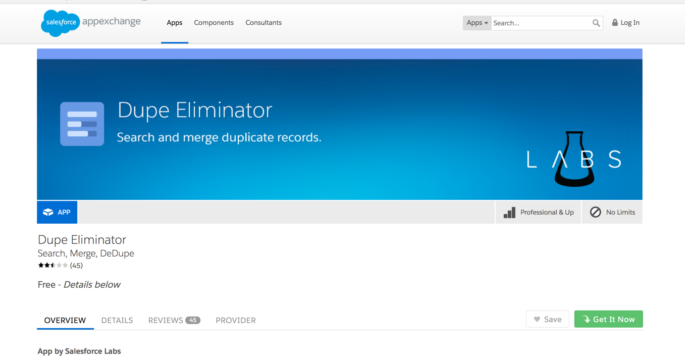
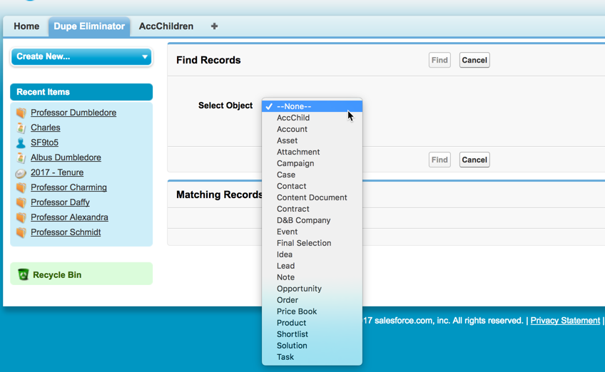
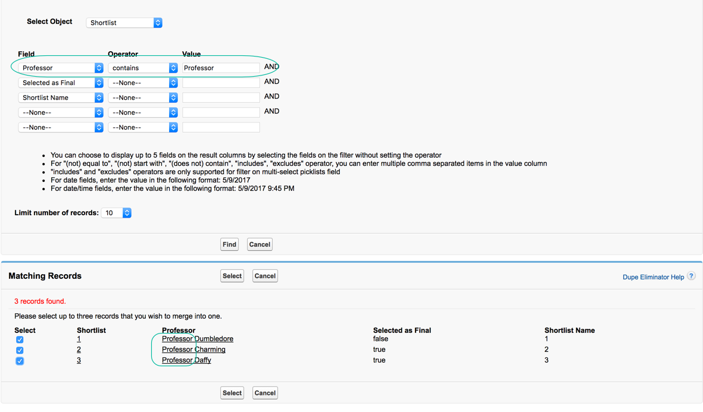
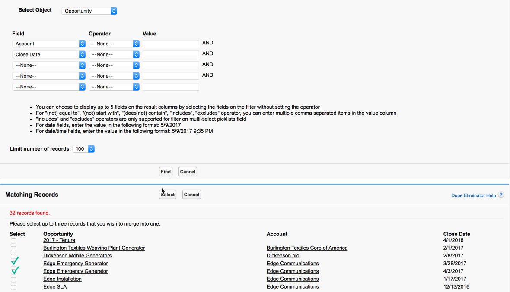
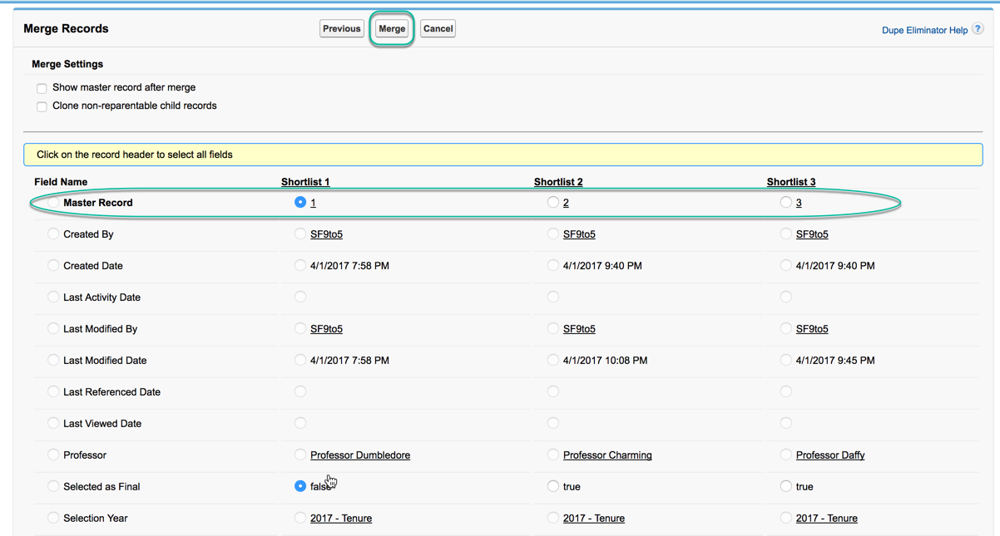

Did you ever want to be able to find duplicates or perform merges on objects other than Leads, Contacts, or Accounts? If the answer is yes, then I can save you the headache of searching 15 more developer forum posts for the solution. [Dupe Eliminator](https://appexchange.salesforce.com/listingDetail?listingId=a0N3000000178g7EAA) by Salesforce Labs is a great free tool that can be found in the AppExchange.

It is a really simple to use tool that will remind you of how native Salesforce handles duplicates and merges. Here's how it works...

Step 1: Download from the [AppExchange](https://appexchange.salesforce.com/listingDetail?listingId=a0N3000000178g7EAA) and install it in your org

Step 2: Select the object you want to find duplicates in or the records you want to merge

Step 3: Add any fields for further selection detail and/or add any filter requirements (Dupe Eliminator allows up to 5)

Step 4: Select the boxes of the records you want to merge

Step 5: Similar to how you would in Merge Accounts, you can view up to 3 records at once and compare them. You can select which record is the Master record and which field data should be included.

Step 6: Merge!

This has to be one of the best simple tools I have found in a while. I appreciate the fact that they allow you to select any standard or custom object and that you can view up to 3 records at a time. Another nice feature, that is something Merge Accounts doesn't allow, is a filter criterion that is something other than the Name.

For its ease of use and headache saver, I give this product an A+.
