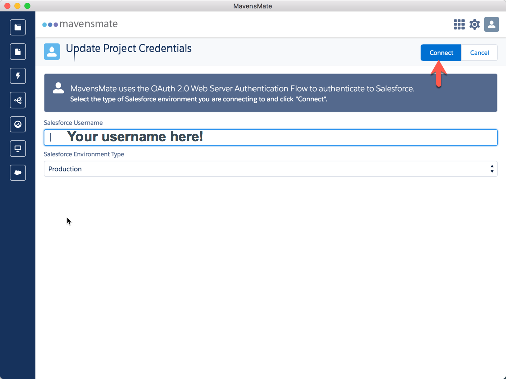
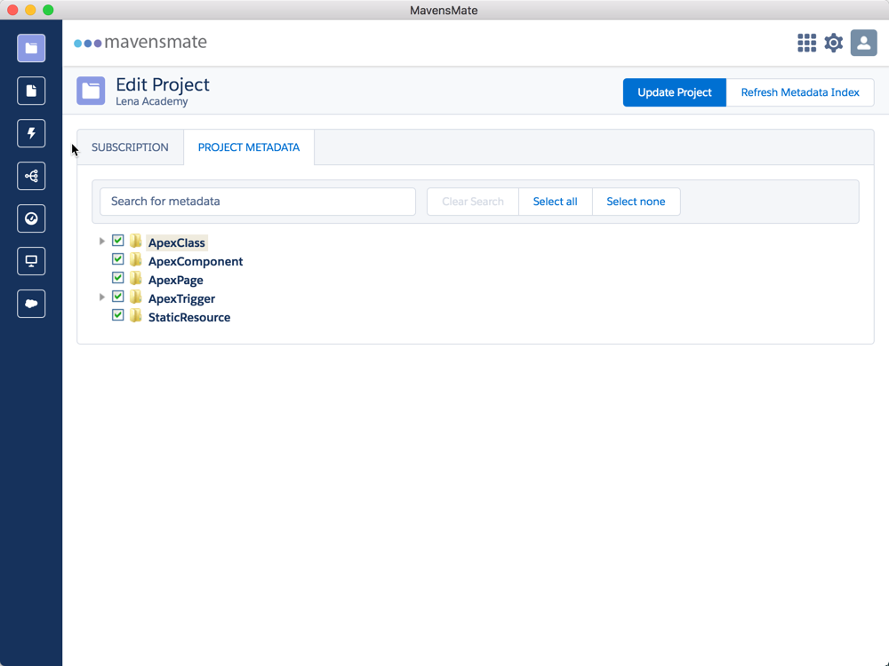
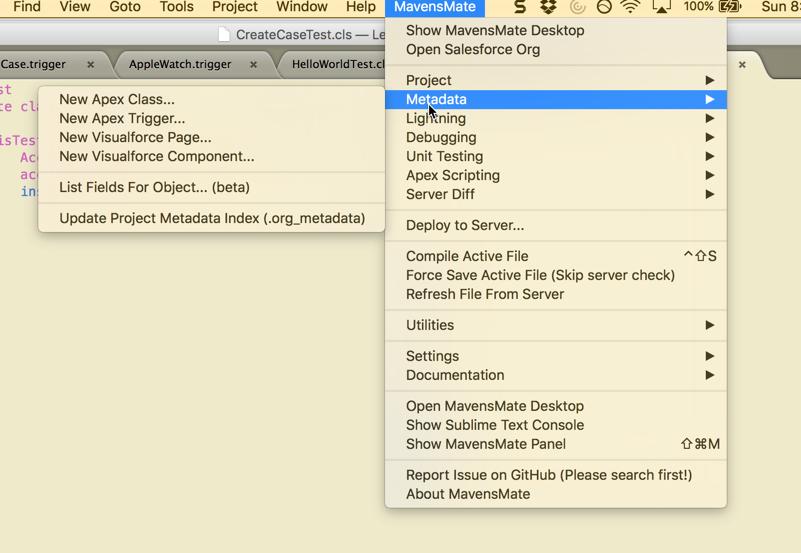
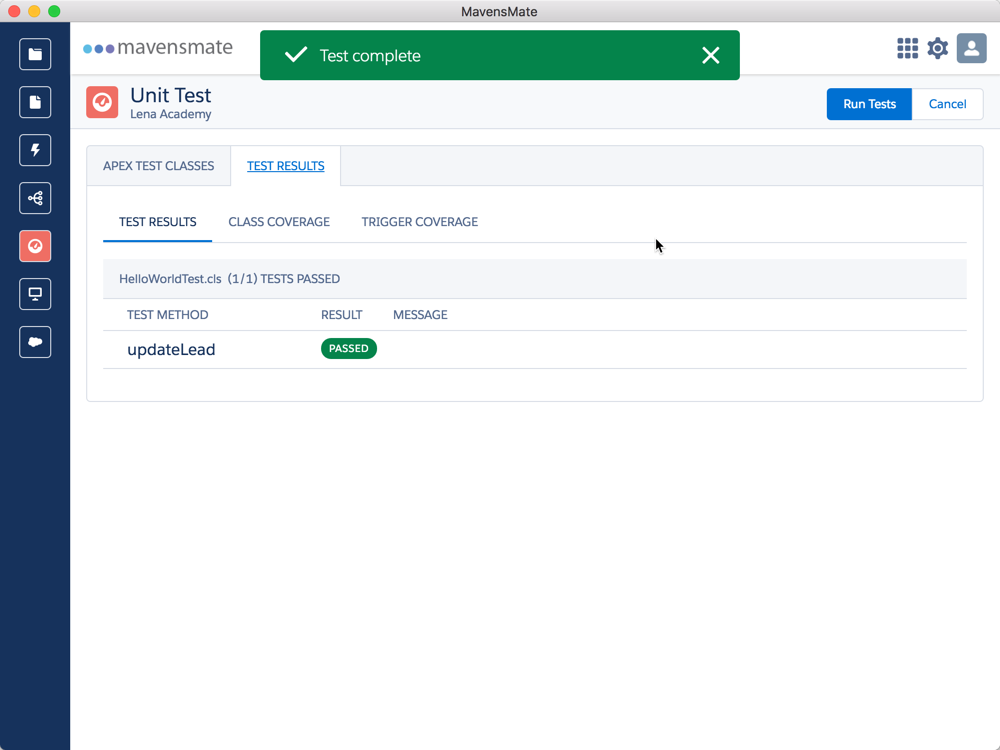

I recently started doing an online course called [Apex Academy](https://app.pluralsight.com/library/courses/apex-absolute-beginner-guide-coding-salesforce/table-of-contents) by David Liu. During the course, it is recommended to use [MavensMate](http://mavensmate.com/) as the best IDE out there for Salesforce development. While I have still quite a ways to go developer wise, I can tell you for sure that MavensMate is the way to go.

Before I dive into what makes MavensMate so special, a couple notes on what makes every other option not so nice. First and foremost there is the development space inside SFDC that can be found by going to Setup and then searching for triggers or class depending on what you are trying to do. I have found this to be relatively useless, especially for a beginner because it is a blank slate, with no auto-fills or really any frills whatsoever. Second, you have the Developer Console. This isn't a bad option, it has a bit color to indicate certain types of elements, but no autofill. Lastly, there is Force IDE from Eclipse, which in my honest opinion is the worst program I have ever tried to download. It took over an hour to get on my laptop, and way to much time to get it to do what I needed it to (I was just trying to access the metadata of an existing class).

Given all of that less than great stuff, I was so thrilled when I heard and then tried out MavensMate. So what is MavensMate? It is a project that has its own app that works in sync with programs such as Sublime and Atom. You basically get to use the editor you are already using and comfortable with (and have probably customized the heck out of) to code for Salesforce, how great is that?!

A couple other things I really like so far about MavensMate is the templates it gives you with the boilerplate code already there for you to get started (which is super helpful for a beginner) and the ability to run test classes directly out of the app.

Overall, I would give MavensMate an A+.

P.S. Come back later if you would like to see a review about the Apex Academy course I am taking.

_8/22/2017 - The creator of [Mavensmate](http://mavensmate.com/) will no longer be working or supporting the tool as he moves on to other projects. As such, within time (probably a few releases) we will need to find an alternative to this wonderful open sourced tool._
