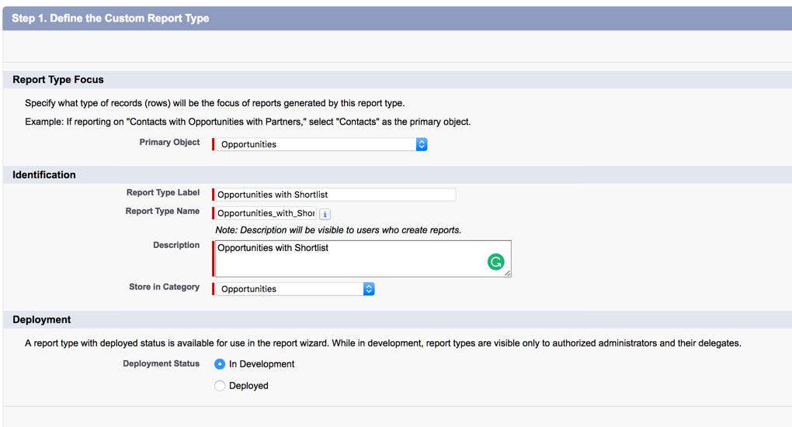
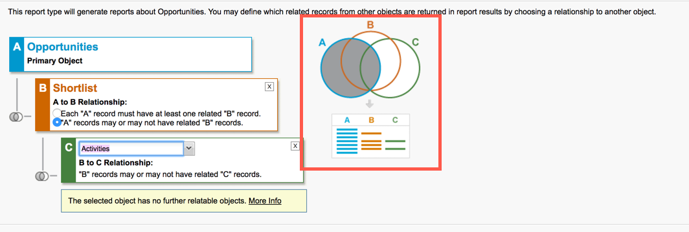
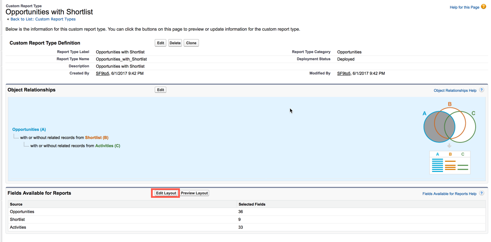
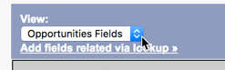
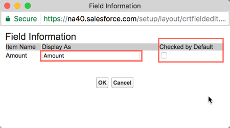

Have you ever had one of those days where you needed a report but no matter which way you turn the ones native to Salesforce, you couldn't get what you wanted? Well if you have, [Custom Report Types](https://help.salesforce.com/articleView?id=reports_defining_report_types.htm&type=0) may be the answer.

Custom Report Types are found in the Setup section of SFDC and are used to do what the name says, create custom report types, the basis for any report. Once created they can be used by anyone in the company the same way one would select any of the native report types.

These Report Types can be used to solve a lot of issues that one may run into while dealing with reporting.

- Wanting to change the label of a column in the report
- Adding additional available fields for an object or related object to the report
- Changing the type of JOIN the objects in the report have (inner vs left)
- Adding additional objects to the report - chose your starting point and go as far down as the Activities or Feed
- Generate Report Types that show [Feed Items](https://releasenotes.docs.salesforce.com/en-us/summer15/release-notes/rn_chatter_reporting_dashboards_pkg.htm) and other Chatter related items

Now that I have given you more than enough reasons to use Custom Report Types, here's how you do it:

1. Go to Setup -> Create -> Report Types
2. Select New Custom Report Type
3. Select the Primary Object - this will be the top most level object you want to work with; Give the report type a name and description and click Next 
4. Next select which Child Objects you want to have included in the report type\[gallery ids="1047,1048" type="columns"\]
5. For each Child Object that you select, you will need to decide if it is an [INNER JOIN](https://www.tutorialspoint.com/sql/sql-inner-joins.htm) or a [LEFT JOIN](https://www.tutorialspoint.com/sql/sql-left-joins.htm) 
6. After you clicked Save, you can move on to the editing of the report type 
7. In the Layout section, you can add additional fields via the object related lookups  And you can change label names of columns and set which columns are defaulted upon creating a new report 

There you have it! Have fun creating Custom Report Types.

\*One word of advice, unless you need to change something in the report type, if it already exists natively (SFDC will create report types off custom objects as well if you check the box to allow reporting) then use the existing option.
