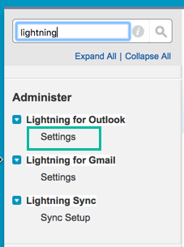
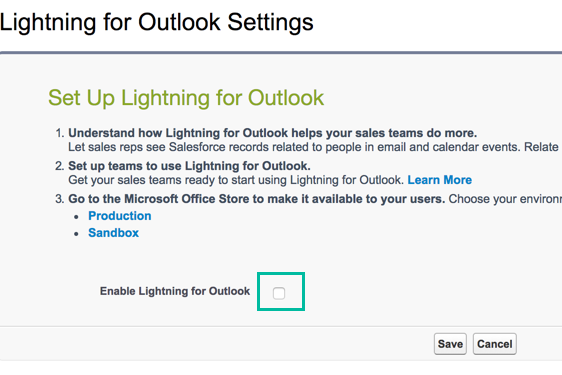
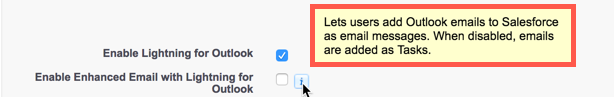
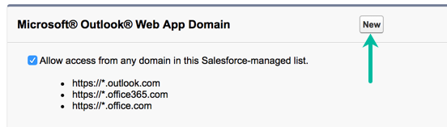
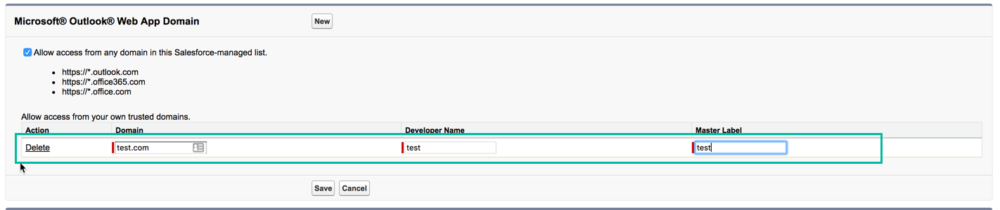
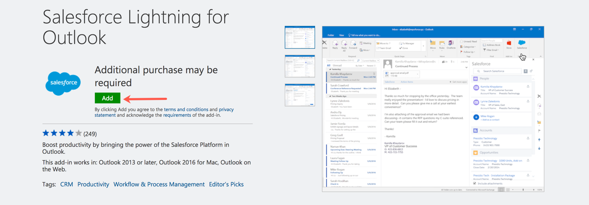
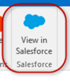
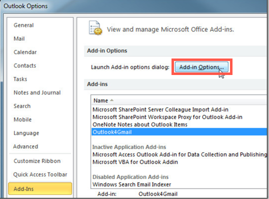
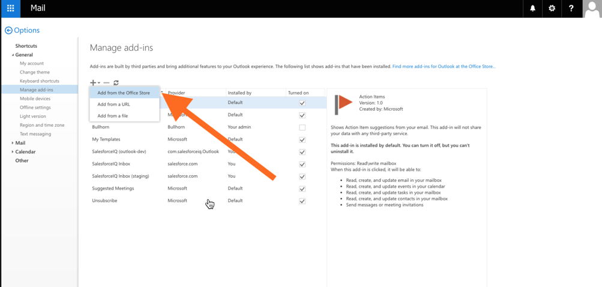

Recently I posted a [comparison blog](http://sf9to5.wordpress.com/2017/06/21/salesforce-for-outlook-or-lightning-for-outlook/) about the differences between Salesforce for Outlook and Lightning for Outlook, Salesforce's two products that are designed to make your sales guys work more efficiently right out of their email client. Similarly to Salesforce, my winner in the race was Lightning for Outlook.

After switching users from Salesforce for Outlook to Lightning for Outlook, I have created my own short how-to that I think is a bit easier to follow than the mass of documents Salesforce provides. Keep in mind this post is designed for Admins, not end users using Lightning for Outlook for the first time.

**Salesforce side setup:**

1. Go sit with someone you like on your IT staff. You will need them for things like your mail domain and potentially installing the add-in.
2. In Salesforce go to Setup -> Lightning for Outlook -> Settings 
3. Click Enable Lightning for Outlook 
4. You may choose to set up Enhanced Email which has the attached emails stored as email in Salesforce instead of tasks - I am going to skip this for now. 
5. In the Microsoft section, select New to add your company's domain - here is where your IT person will be helpful. Once you are done filling out the information click Save. 

**Microsoft Outlook setup:**

Option 1 - Assuming you are running on Microsoft OWA and can access your email via [https://outlook.office.com/owa/](https://outlook.office.com/owa/) then you can follow these steps.

1. Go to [https://store.office.com/en-us/app.aspx?assetid=WA104379334&ui=en-US&rs=en-US&ad=US&appredirect=false](https://store.office.com/en-us/app.aspx?assetid=WA104379334&ui=en-US&rs=en-US&ad=US&appredirect=false)
2. Click the Add button 
3. Follow the steps by logging into your work account
4. After completing the login and confirmation steps you can open Outlook and you should see the View in the toolbar - if you had Outlook open you may need to restart.
5. You will need to click on the View and then sign in using your Salesforce credentials 
6. You are all set! You can use the thumbtack in the upper right-hand corner to pin it the window so it's always open.

Option 2 - If you are unable to use the link above then follow the steps below.

1. Open Outlook and go to File
2. Select Options -> Add-Ins -> Add-In Options 
3. This will launch the Manage Add-Ins window in your browser
4. From here click on the Add from Office Store found in the + icon 
5. You can then search for Lightning for Outlook in the store
6. Once you have found the app click Add 
7. Follow the steps by logging into your work account
8. After completing the login and confirmation steps you can open Outlook and you should see the View in the toolbar - if you had Outlook open you may need to restart.
9. You will need to click on the View and then sign in using your Salesforce credentials
10. You are all set! You can use the thumbtack in the upper right-hand corner to pin it the window so it's always open.

 

_Let me know in the comments if you would like a short tutorial on how to change the layouts in Lightning for Outlook or if a user guide would be helpful!_
