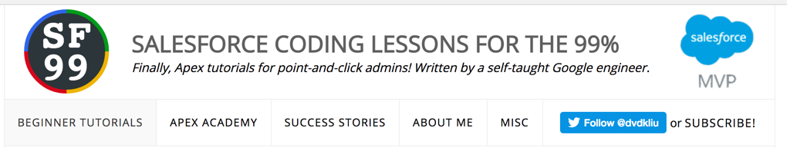

I recently started my journey into learning more about how to do code development within Salesforce. I felt a need or dare I say an itch I needed to scratch, to better understand what is going on beneath the hood in all of my Apex classes and triggers.

As a good place to start, I was referred to by the Internet gods, to try out [Apex Academy](http://www.sfdc99.com/apex-academy/) which is created by David Liu ([sfdc99.com](http://www.sfdc99.com/)) and hosted on the [PluralSight course site](https://www.pluralsight.com/courses/apex-absolute-beginner-guide-coding-salesforce?utm_source=sfdc99&utm_medium=video&utm_campaign=authordemo). Starting on his website, I was able to get a pretty good feel of how and what the course would contain and it was definitely enough to peak my interest.

Before I dive further into my review of the first part of this course, I want to share some background about myself, as it will show some of my possible biases when it comes to coding. In college, I studied JAVA, VisualBasic, SQL, and something else that I cannot remember. Finally, post-college in one of my first jobs I tried to work in Python by doing codeacademy. At this point you are probably wondering why I just listed every code language I have touched, well the point is I have tried to learn these many different languages, and with the exception of passing my college courses and being able to make websites, NOTHING ever stuck and I most certainly could not go bust out some wonderfully useful code for anything.

That being said, Apex Academy/ David Liu has somehow found the perfect spot where it is making the information stick and is actually usable outside of the virtual classroom. Trust me, I was totally suspicious before I started...I figured this would be another codeacademy course, that goes in one ear and out the other, but it's not.

This course treats you like a smart adult and understands that you may have no coding experience but tries going at teaching code through a completely different method than the standard way. David makes sure to always cover the basics, but instead of just giving definition after definition with only a useless example, he gives everything he says a real-world Salesforce example that you go and apply today.

So far with this course, I have been able to learn how to write basic triggers and how to create tests classes, which David has done a successful job of making me love. I have also learned the key fundamental building blocks that one will need for creating triggers of any type.

This [course](https://www.pluralsight.com/courses/apex-absolute-beginner-guide-coding-salesforce?utm_source=sfdc99&utm_medium=video&utm_campaign=authordemo) is followed by two more courses that get slightly more advanced with each round. This is the shortest of the 3, as the second is many hours long. However, I think this is worth my time and my money to PluralSight.

Stay tuned, as I will be posting about the 2nd and 3rd courses as I complete them.
