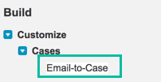
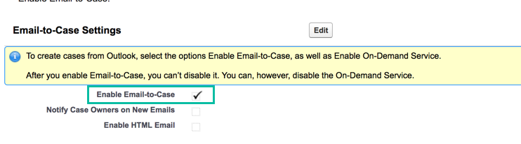
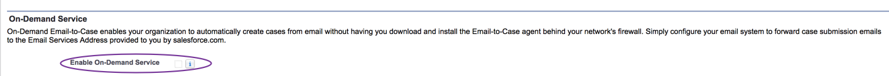
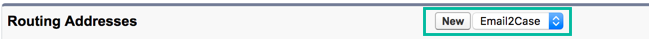
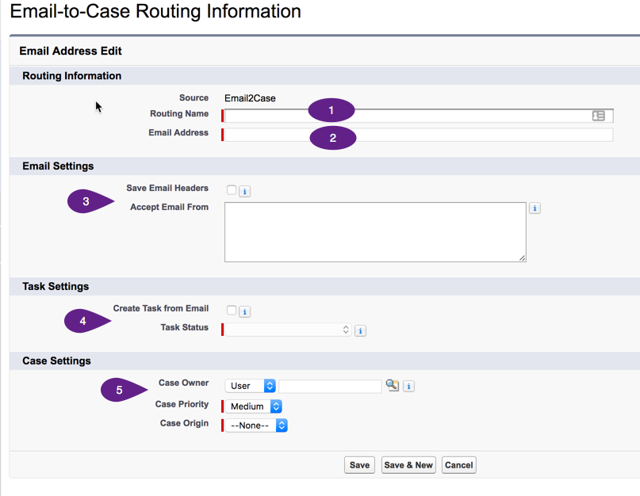
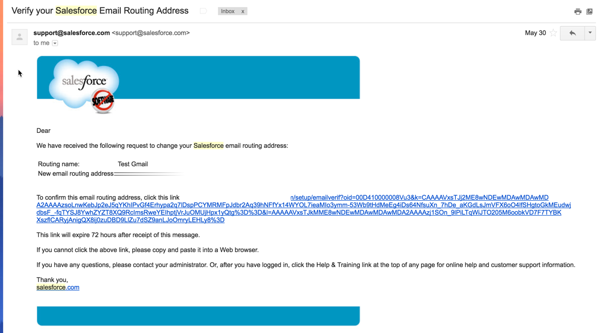
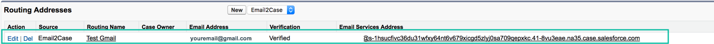
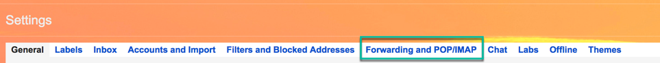

Whether you are just starting out in Salesforce or you have been doing this for while, you are bound to have heard the phrase "Email-to-Case", but what does that really mean? In the Salesforce ecosystem that means that an email gets sent to a Salesforce generated email address that is setup using a forwarding system, and then from that email, a Case record is generated.

This tool is highly used in most companies by their support team, whether it is for external cases or for internal use cases. Knowing how to properly set this tool up and test it [outside of the Production environment](http://sf9to5.wordpress.com/2017/07/18/release-management-for-salesforce-admin/) is important.

To get started with the setup, you first need to define the business use case for Email-to-Case as once you turn this feature on, it cannot be turned off (although you can prevent emails from coming in). Once you know who will be sending what type of cases you can start to build your framework for testing.

## Configuring Salesforce

1. In a developer or sandbox environment go to Setup -> Email-to-Case 
2. Click the Enable Email-to-Case checkbox to turn this on 
3. Since we are doing this via Gmail (and I don't have any special firewalls to install the case agent behind) we will also turn on the Enable on Demand Service 

After we complete the initial turn on of the features we will need, it is time to create the address to which the email will need to be sent to. You do this by clicking the New button in the Routing Address section (with Email2Case selected). This will give you a screen with some important fields to fill in.

1. This is the name of the Routing Address; something like Email 2 Case
2. This is the email address you will be used for forwarding (so in the case of Gmail - _yourGmailaddess@gmail.com_)
3. Here you are given the option to save Email Headers and specify specific email address domains you will allow these cases to be created from.
    1. I do NOT recommend saving Email Headers as this will take a lot of data space
    2. Specifying domains can be useful if you know definitively who will be sending in the cases so you can block out spam. However, if this is for external purposes you may not want to filter as you may lose important data.
4. This is the option to create a task (to-do) item based on the created Case
5. This your place to set some of the basic details of the Case, such as the owner and the priority. (If you need to set more filters or fill in more field upon creation, look into Workflow rules or Process Builder).

Once you click Save you will be prompted that you need to look for an email at the address you specified in #2 to verify the address.

After you have verified your email address, back in Salesforce you will be able to see the new forwarding address.

Now for the FUN part in Gmail.

## Configuring Gmail

Once you are logged into your account, click on Settings and then click on "Forwarding and POP/IMAP".

Select Add a new Forwarding Address and fill in the box with the address provided by Salesforce.

\[gallery ids="1366,1367" type="rectangular"\]

Once this is all completed you can begin testing. You will need to send an email to the Gmail account used - this will create a new Case in Salesforce.

When you are ready to push live in Production, it is highly recommended that you associate the email address provided by Salesforce with an alias address that will be easy for your users to remember and not something personal as was used in our example.
