If you use CPQ in your organization, your users may not always remember to add related products when they configure a quote, and you may not necessarily the items bundled. What do you do to ensure they don't forget? You use the built-in alert function of CPQ.

## Business Case

You have two products, Laptop and Charger, and you want to ensure that when a quote is created for a Laptop that the user didn't forget the Charger. Your users may forget to include the Charger as part of the quote and you need to remind them about this product.

## Business Solution

Since we only need to remind the user to add the Charger, but not force the purchase of it, we can use an Alert in CPQ to the tell user 'Hey, Don't Forget to add a Charger!'. This will still allow the user to proceed with the quote in the case that the customer already has a charger and doesn't need another one.

To create an Alert, we will need to create a Product Rule, 2 Summary Variable, and 2 Error Conditions. The connection between these objects is depicted in the following diagram: 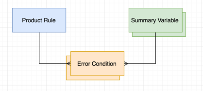

My Summary Variables are going to be the variables we are checking for in the Product rule; in my case, I am looking for LAPTOP and CHARGER as the Product Code. For my Error Conditions on the Product Rule, I am going to specify to look for at least one Laptop (greater than or equal to) and that there is less than one Charger.

## Steps

### Create the Summary Variables

_Since we need the Summary Variables for the Error Conditions within the Product Rule, we will create them first._

1. Go to the Summary Variable object and click New 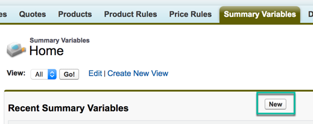
2. For the first rule fill out the fields that are highlighted below (\*note that in your own environment you may need to make some adjustments) 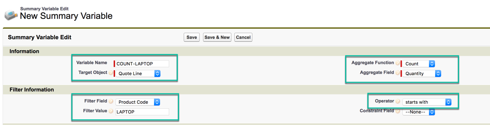
3. For the second rule fill out the fields that are highlight below 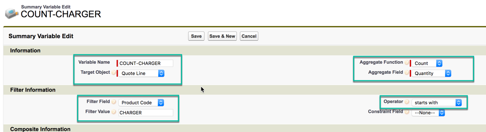

### Create the Product Rule

1. Go to the Product Rules object and click New 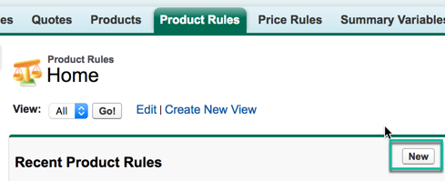
2. Create a name that is relevant and meaningful to you and future folks
3. Fill out the fields as they highlighted below. IMPORTANT - Do not forget to mark the rule as Active! 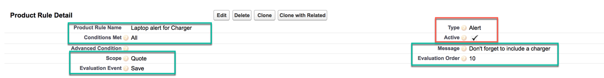

### Create the Error Conditions

1. After you have saved the rule, click New in the Error Conditions related table 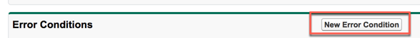
2. For the first rule, fill out the fields that are highlighted below (\*note that in your own environment you may need to make some adjustments) 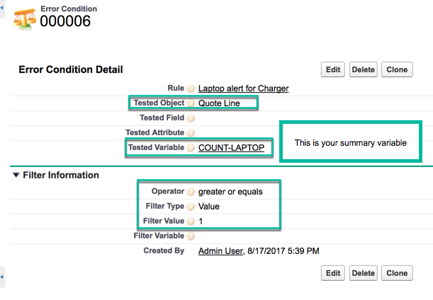
3. For the second rule, fill out the fields that are highlight below 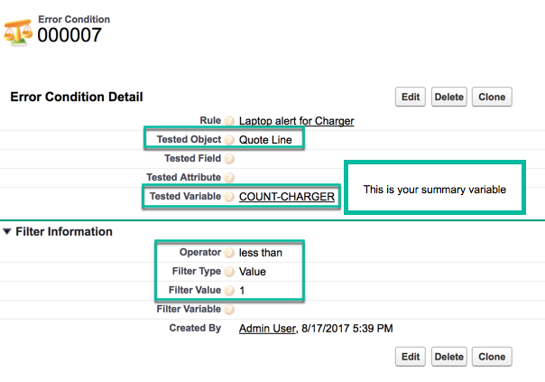

### Test! Test! Test!

1. Create or open an existing quote ( I recommend using a quote that doesn't have any line items to prevent misfires of other rules if you are testing this use case specifically)
2. Click Edit Lines
3. Add your Laptop Product 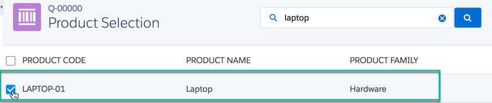
4. Click Save 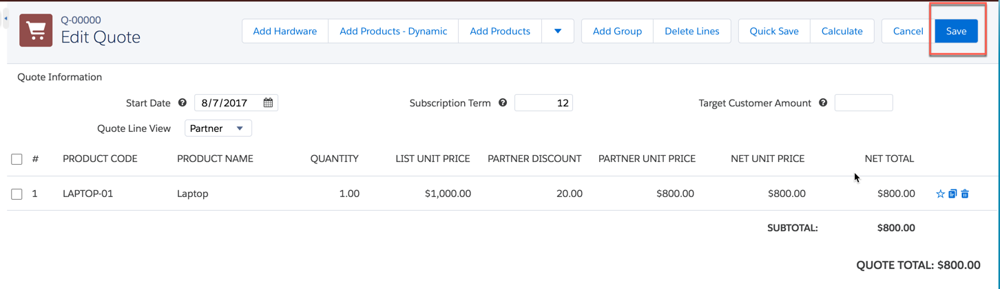
5. You should see an Alert pop-up with the message that you entered in the Product Rule 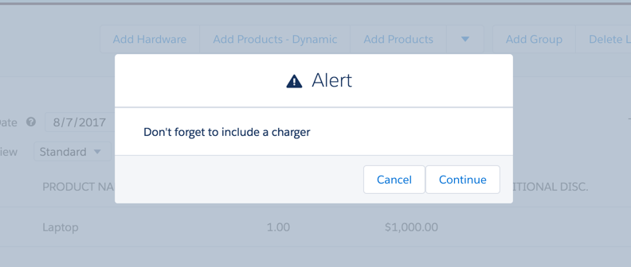

You are all set!
