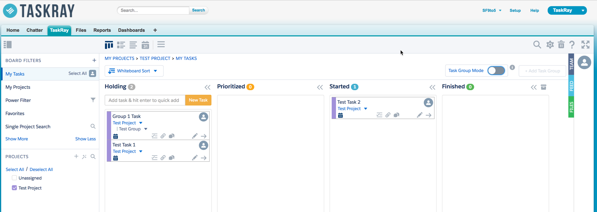
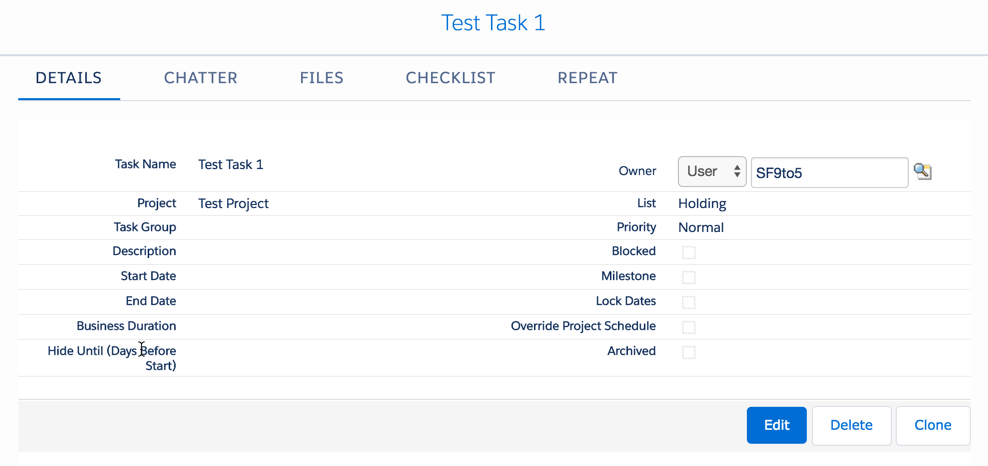
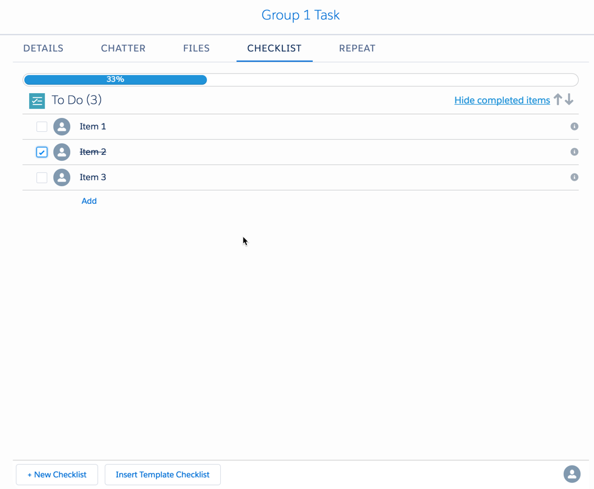

Have you ever thought about or had the desire to handle your project management case load inside Salesforce instead of through another application? Well, today is the day to learn about TaskRay, a "modern project management" system that is natively built within Salesforce as a Lightning App.

[TaskRay](https://taskray.com/) was presented to me as a valid option when I was looking for a tool that could do what [JIRA](https://www.atlassian.com/software/jira) does but within Salesforce. Given my previous experience with JIRA, I had set my expectations high as I quite like JIRA as a project management tool. While initially, I was skeptical, I'm here to tell you that TaskRay does deliver.

TaskRay, out-of-the-box comes ready to go, with little to no dev work necessary. When you open up TaskRay for the first time after installing, you see this lovely Kanban view, perfect for your [release management](https://focusonforce.com/process/salesforce-release-management/) needs. The panels are ready to go and asking for tickets. There are many different view options depending on your needs and style, including Kanban, Gantt, Calendar, and List.

The first step to getting started after installing would be to [create a couple of projects](https://support.taskray.com/hc/en-us/articles/236408707-Create-Projects) and then start creating tickets within the projects. It is so clean and easy to maneuver that you will quickly fall into an easy ebb and flow with the product. (As a hint, don't ever leave a ticket with a project, it may get lost in the ether.)

Another nice feature of TaskRay is that they provide you with an email service class out-of-the-box so you can setup an email to Salesforce functionality if you want users to create tickets via email. This is a great option if you are intending on using TaskRay in any sort of support setting. Part of the email service is that when an email comes in, the body is used to create a chatter feed post and if there are any attachments as part of the email they are included as files on the ticket.

The last neat feature I want to call out is the checklist tab. Here you can actually list out (in as many lists as you want) the items that need to be completed. You can also assign the different items within the checklist to different folks, despite the owner of the actual ticket. This is great for dividing and conquering when a ticket may have many steps and needs many people to touch it along the way without having to move the ticket between people.

The biggest and most important factor is that TaskRay really relies on Chatter and more recent Lighting features. To really benefit the out-of-the-box functionality, using Chatter is crucial to your deployment, so keep this in mind when deciding if TaskRay is right for you.

Overall, I give TaskRay an A for its all around good use and out-of-the-box features.
