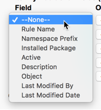

Have you ever had a time where you needed to know what workflows were going to run in your Salesforce instance?

## Business Case

Say you have a large data update that you want to run through the system and the data will impact Leads and Accounts. Before running the update, you want to know if there are any email alerts that may get sent out because the data update will trigger those workflow rules. Unfortunately, out of the box, Salesforce only allows you to filter so far, giving only the options really to see which rules run on a certain object and if they are active.

But in this case, you want also to filter by the evaluation criteria and if the action type is email alert and you don't want to have to go one by one through every active Lead and Account workflow rule you have - depending on your number of rules this could be dizzying very quickly.

## Business Solution

To answer the above business case, I worked with my developer partner to help create a tool that will allow you to get more specific in your Workflow filtering requirements. We ended up with ["Workflow Filter"](http://sf9to5.wordpress.com/salesforce-tools/workflow_filter/), a tool which allows you to set the parameters you need based on Object, Action Type, and Evaluation Criteria. The results give back the ID and name of the rules that match your specified inputs.

The [Workflow Filter tool](http://sf9to5.wordpress.com/salesforce-tools/workflow_filter/) is Python based and can be easily and quickly run through the command line, giving you a simple text file as the end result. To learn more about the tool itself and to download it, visit [https://sf9to5.wordpress.com/salesforce-tools/workflow\_filter/](https://sf9to5.wordpress.com/salesforce-tools/workflow_filter/).

As always, this tool was designed and developed to address a specific business need that I encountered. We open sourced the tool and you may adjust it to meet your needs.

If you have any questions, please feel free to contact me at yelena@sf9to5.com.
