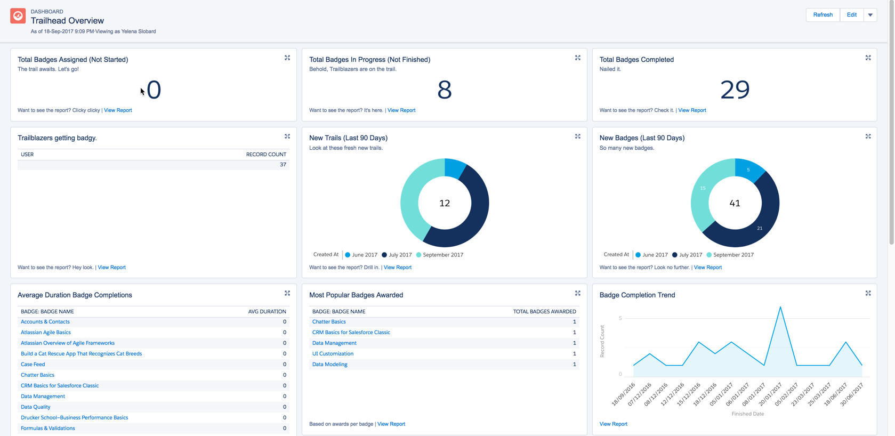

This post is a long time coming and I don't mean because I am 2 months behind the release (plus some additional time due to Trailhead Tracker being buggy). Back when I started as an admin I was tasked with figuring out how to provide a Salesforce 101 training to my end users. I was already obsessed with [Trailhead](https://trailhead.salesforce.com/) and it's wondrous ways of teaching that I wanted to be able to utilize that to its fullest potential for training.

However, at the time I was tasked with this, Trailhead required a Dev account and was inaccessible via a company's Production org. As a result, I ended up creating my own training 101 utilizing a sandbox and a word doc with specific Trailhead links. (If you want to learn more about that you can check out my blog post on [Training your employees with Trailhead)](http://sf9to5.wordpress.com/2017/02/23/using-trailhead-to-train-your-employees/).

I had spoken with Salesforce back then and they had told me no one had asked for such a thing, which completely shocked me as I was thinking why wouldn't Admins want to use Trailhead to train? Well, clearly there was some miscommunication because here we are around a year later and FINALLY Salesforce has a tool that allows users to connect to Trailhead via their Production org.

The tool is called [Trailhead Tracker](https://appexchange.salesforce.com/listingDetail?listingId=a0N3A00000EFpAtUAL) and its concept is so simple yet so glamorous. It's installed package designed primarily around allowing you, the admin, to track your users' progress in Trailhead. The feature I love most though is that you can assign users specific trails. I don't know about you, but the number of places to explore in Trailhead can get overwhelming and that is definitely not a feeling your users should have.

Trailhead Tracker also comes with pre-built reporting and dashboards, so as soon as you install and your users start completing trails you are off to the races.

Anyway, thank you Salesforce for fulfilling a request I so very much wanted!

P.S. One caveat to point out in regards to setup and synchronization - Salesforce and Trailhead will only sync ONCE a day. Make sure to check out the setup instructions found [here](https://quip.com/AVc8Aouc4Lzx).

 

\[gallery ids="1809,1808,1807,1806" type="slideshow"\]
