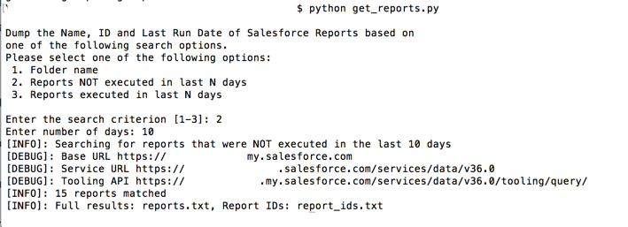
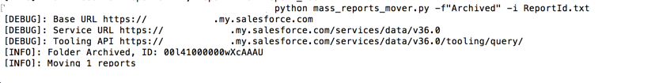

Have you ever needed to be able to move hundreds, if not thousands of reports in Salesforce? Well, I recently needed to move over 10K reports and since Salesforce has not provided a solution for this yet, I came up with a tool that allows such movement.

## Business Case

I was recently inspecting one of my Salesforce org to do some cleanup and found out that I had over 10K reports that had not been touched for at least 2 years. Once I found this out, so began the research project of figuring out the best way to clean this up. For sanity sake, I wanted to first move the reports out of view before considering to delete them. This way if someone hollers when the report goes missing, I have a very simple way of moving it back to where it came from and in front of the person hollering. (Of course, if I were to just delete it, I could use a backup or recreate it, but I believe this is the easiest route).

Through my research, I learned that Salesforce has yet to provide a solution of their own for mass moving reports, although they have resolved mass deleting as long as you are in one place. I also decided that while there was a solution that could be done through Eclipse, everyone's description seemed highly clunky and in many cases did not actually work out for them. As a result, I decided to call on my developer partner to give me a hand.

## The Solution

Working with my developer partner, we decided again that the best route would be a simple CLI tool written in Python. The tool - [Mass Reports Mover](https://github.com/ysfdc/salesforce_scripts/tree/master/reports_mover) - covers all of the necessary basis to go from A to Z for my business case. The get\_reports.py script allows me to get all of the report IDs based a criterion that I set and delivers the results as just IDs in one text file and a second text file with the Report Name, ID, Folder and the last run date (also known as executed date).

With the ID file in hand, I can then run mass\_reports\_mover.py, which will allow me to specify which folder to move the reports to. Voila, that's it, reports moved!

An alternative process, if you do not want to do this on your production, is to use an XML changeset like the one provided by [Snapshot from Dreamfactory](http://sf9to5.wordpress.com/2017/03/08/review-dreamfactory-snapshot/) to actually push the changes to the Production environment.

The tool, installation, and usage instructions are available on my [Github account](https://github.com/ysfdc/salesforce_scripts/tree/master/reports_mover). In order to use it, you would need to have Python installed on your computer.

## What are the side effects?

One of the most important questions I asked myself was how moving over 10k reports will affect my organization. So, here are the side effects that I'm aware of:

- Using Salesforce API to update the report will change the LastRunDate value. We ruled out a bug in our tool as it also happens when we used Workbench. When moving using the Salesforce UI the date does not change. We do not know whether or not it actually executes the report.
- Each report equals one API call - be cautious when moving thousands of reports at once.
- When moving reports to a new folder, make sure the right users have permission to access that folder (unless you don't want them to have access like in my case).
- With the tool, managed and non-managed reports will be moved unless you have excluded them from your ID list (manually)

As part of the testing, I also ran a comparison of the XML metadata of a report before and after it was moved using the tool. There were no visible changes in the XML metadata after the move was completed.

## Limitations

- No support for Join Reports: It appears that you cannot use the official Salesforce Reports and Dashboards REST API to update Join reports. While testing the tool, we found out that the API returns HTTP code 501 with the error message NOT\_IMPLEMENTED. You can, however, move the report using the UI.
- No support for reports with bucket fields: When attempting to update the report metadata using the Salesforce Reports and Dashboards REST API, we got the error message INVALID\_REQUEST. Digging through the error details, we found out that the bucket field must also be moved to the new folder and the bucket fields in the report metadata need to be updated.

The tool was developed to help myself move over 10k reports. While it may not be ideal, or not relevant for all organizations, the goal of this post is to share the research that was done in an attempt to solve this issue.

[Mass Report Mover Github](https://github.com/ysfdc/salesforce_scripts/tree/master/reports_mover)
