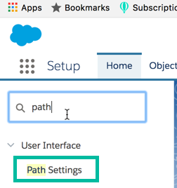
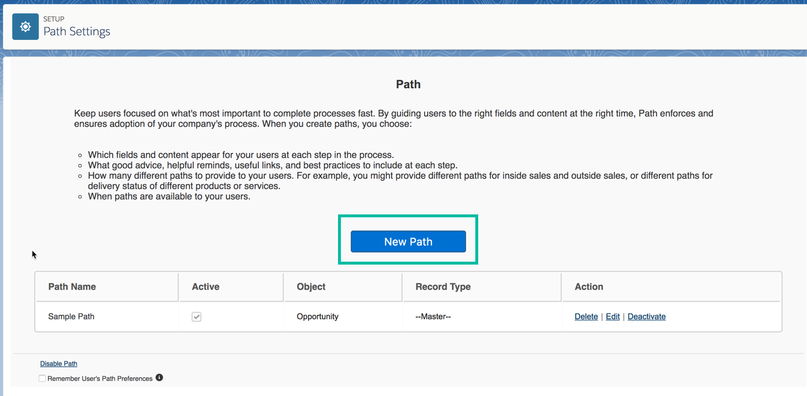
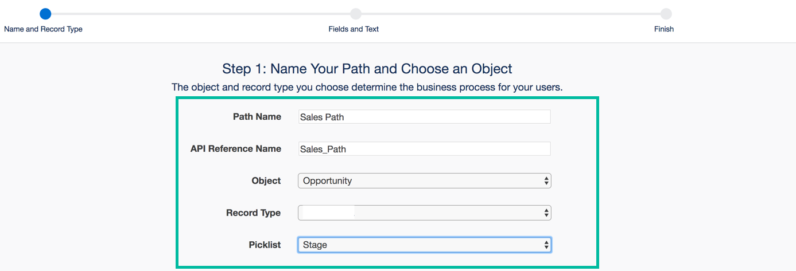
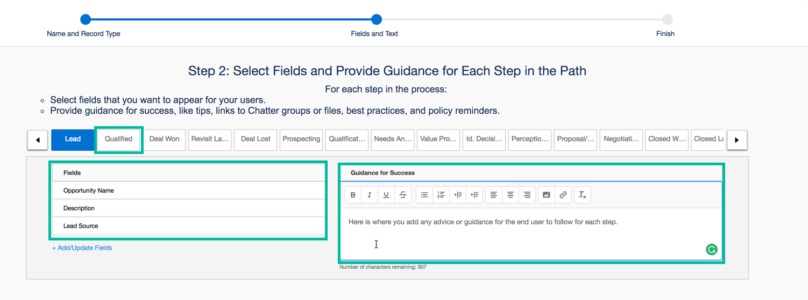
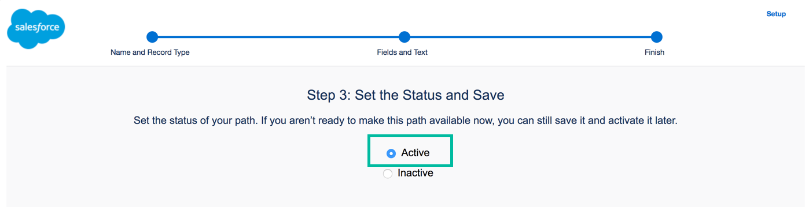
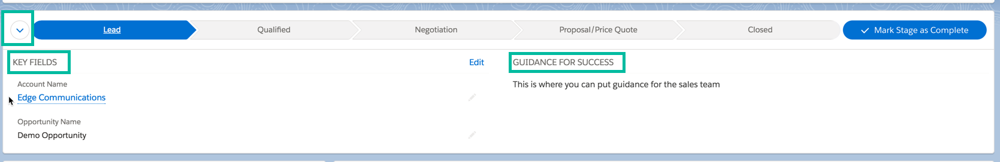

I am slowly edging my way into the Lightning Experience and one the elements that caught my eye early on was Sales Path. Sales Path, now just Path, is this wonderful tool that can be used on almost any object, both custom and standard, that will help your end users (all of them, not just Sales) become more efficient at their job. The reason why they will become more efficient is that you can layout in an easy to read format the steps they must go through and provide them guidance for each step along the way.

Here is how you set up Path:

1. Go to the Settings and find Path Settings 
2. Create a New Path (hint: make sure that you have your record type and process- if relevant- set up before creating the path) 
3. Fill out the information, including selecting the Object, the Record Type, and the field the stages should be based on 
4. On the next screen, there are two main elements to complete 
    1. The Guidance for Success
        1. For each stage that you have pertinent information to share, add it here - you can have links to additional instructions, or files that perhaps the user needs to complete, or even images can be uploaded.
    2. The Key Fields
        1. For each stage that has specific fields that need to be filled out, you can include them at the top which calls them out to the user
5. Last and most importantly, click Activate for your Path to be used on a record page. If you are not ready yet, you can leave it Inactive, but don't forget later to activate it. 

Here is what the final result looks like in my org (remember everything you see is customizable so yours might look different): 

One last reminder, if you are testing this, make sure that if you have more than one record type for the object you are on, the record you are viewing is the correct record type.
