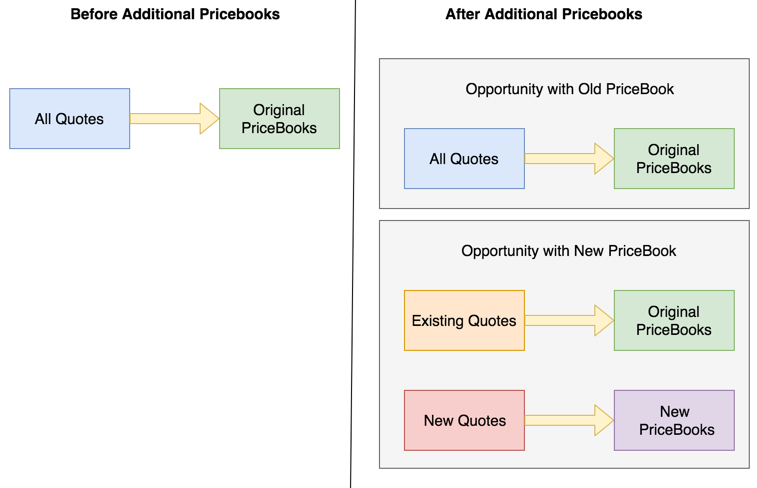

Recently on a project, we were looking into how to maintain the old pricing for existing quotes and use new pricing for future quotes. Up until this point, the client had been overriding their existing pricebooks. To support two prices, we decided to create new pricebooks in addition to the existing ones.

In order to proceed with implementing our decision, we had to figure out what would stay with the old pricebooks versus what would roll to the new ones. The decision was to move all open Opportunities to the new pricebook, but leave the existing quotes on the old pricebook. All Closed Opportunities would be left with the old pricebook for historical reasons.

These are the steps I took to implement the above solution:

1. Create brand new price books for all relevant currencies
2. Upload all of the new price book entries
3. **CRITICAL STEP -** Run a report with all of the open Opportunity Data that your company finds important, even if you aren't planning on touching it - include the 18 digit ID in case you need to do any external lookups (i.e. Excel)
4. Based on the report in #3, check the value of all the open Opportunities - you will need this at the end to verify that you've maintained the original sum of values
5. Run a report to pull all open Opportunities with Primary quotes
    1. Via whatever tool (e.g. [Enabler4Excel](http://sf9to5.wordpress.com/2017/04/06/review-enabler4excel/)) or method, uncheck all of those Primary quotes
6. Run a SOQL query using [workbench](https://workbench.developerforce.com/) to find any open Opportunities with OpportunityLineItems - sadly this is the only tool I found that gave me access to that specific object
7. Delete what you found in step 6 - without this step, you will not be able to change the pricebook on the Opportunity; You will get the error 'You cannot change pricebook with product lines'
8. Update the amounts of the Opportunities based on the report you ran in step 3 - without doing this, the amount field will be zero
9. Update the pricebook on the Opportunities to the new pricebooks
10. Re-run the report used in #3 to double check the values sum up the same

Before you proceed, you can prepare the environment using these steps:

1. Turn off CPQ triggers in the Configuration tab for Salesforce CPQ
2. Turn off Email Deliverability in Setup
3. Disable all triggers and workflow rules

If you read my post about [Release Management for Salesforce Admins](https://focusonforce.com/process/salesforce-release-management/), you would know that prior to running through the above steps in a Production environment, I highly recommend that you do it first in a Full Sandbox.
