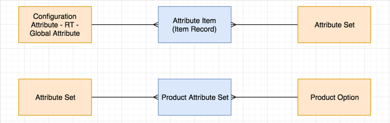

Typically the release cycle for CPQ does not contain many items, however, the items it does include can be pretty useful. [Winter 18 release](https://community.steelbrick.com/t5/Release-Notes/Salesforce-CPQ-Winter-18-Release-Notes/ta-p/18550) focused on three aspects: Global Attributes, Percent of Total Products, and Order Product field updates.

## Global Attributes

Global Attributes is a new **record type** that expands the already existing functionality of Configuration Attributes. Global Attributes do not need to be associated to a specific Product Option (PO), it can be used across many different POs and it can save you having to create an extra PO just for the Configuration Attribute.

The only two requirements when setting up a Global Attribute is a name and a target Product Option field. One important note about how the Global Attributes work with regards to rules is that any Apply Immediately functionality does not apply when a value in a Global Attribute is changed.

There is a bit of setup from the admin side to do for utilizing Global Attributes. In addition to what is provided on [the Steelbrick site](https://community.steelbrick.com/t5/Products-Bundles-Knowledge-Base/Global-Attributes-amp-Product-Option-Drawers/ta-p/18580), here is a diagram of the objects and how they relate to each other:

## Percent of Total Products

As part of the Winter 18 update, when one or more subscribed assets are ordered, CPQ automatically includes the % of total as an order line on the new order. Subscribed assets can also be distributed (for a single product) over multiple orders. Each order will contain a single order line item for that % of total product.

Percent of total products will no longer appear to the user to select on the product page.

## Order Products

There were several new fields added to the Order Products object. These fields help to better expand the functionality and reportability of the Order and Order Products object.

- Subscription - lookup
- Asset - lookup
- Contract - lookup
- Terminated Date - date field automatically populated when an order is canceled

If you would like to learn more about what Salesforce says is down the road for CPQ make sure to check out my [What’s in for CPQ down the road?](http://sf9to5.wordpress.com/2017/10/18/cpq-roadmap-18/) post.
