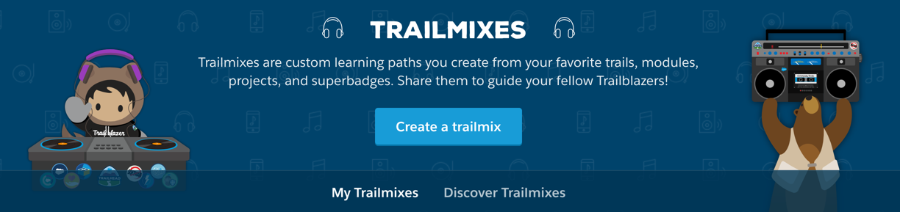
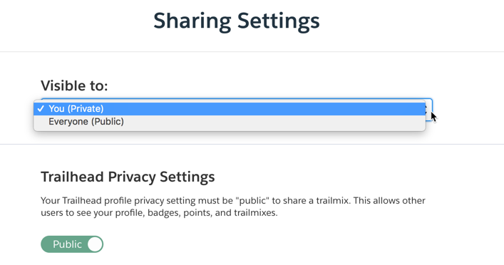
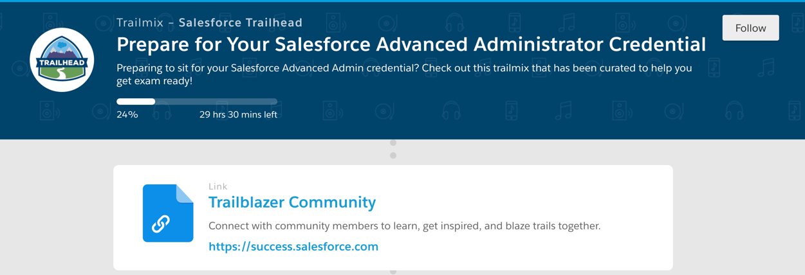
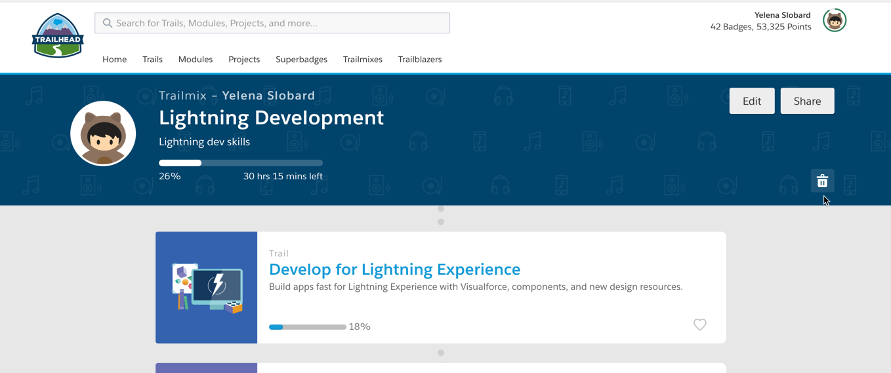

Not that long ago, Salesforce Trailhead released Trailmixes, a wonderful addition to the Trailhead setup! Trailmixes allows you to create customized trails based on your needs and requirements.

When I think of Trailmixes, with it now being available for many months, I think of it two-fold. The first is the ability to create customized plans for training your staff. Say you have an enablement team that wants to get their Sales force up and running on Salesforce. Instead of having to create a bunch of custom material, they can pull together different modules or trails to create a tailored Trailmix program. Once built, it can be shared via URL amongst anyone who needs it.

The second half of Trailmixes that is awesome is actually what Salesforce has gone ahead and done with it. As part of many of the certification guides, now you will find a recommended Trailmix to get you through the knowledge base. What I like about this setup is that the Trailmix includes all of the material, including PDFs, Links, and the necessary Trails. One of the nice examples of this that I have found is the Advanced Admin Trailmix.

This includes the PDF with the exam guide, as well as, the recommended Trails to complete. As a nice finishing touch, much like the rest of Trailhead, I get an estimate of how long it will take me to complete the Trailmix.

I personally have gone in and created one Trailmix for my own personal development based on Lightning Components. Setting it up was super simple, just a matter of clicking 'add' on the modules or Trails that I wanted to include, give the Trailmix a name and voila, I was done and ready to hit the trail.

Overall, whether you are studying Salesforce on your own or you have a team that needs to learn Salesforce, utilizing the Trailmix option inside Trailhead is the right way to go.
