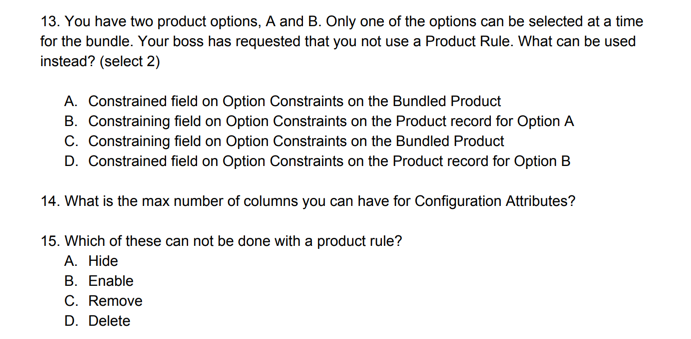
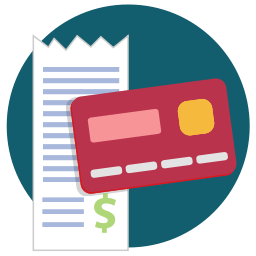

It's here! Finally, a practice set of more than 70 questions for the CPQ Specialist exam which is roughly broken down based on categories provided in the [Salesforce exam guide for CPQ](https://trailhead.salesforce.com/help?article=Salesforce-Certified-CPQ-Specialist-Exam-Guide#outline).

These questions vary in type from multiple-choice, true/false, and some single-answer questions. Most of the questions are also asked in a scenario/ business case format, with some more purely knowledge base - similar to what you might see on the exam. While not 100% in the same format as the exam will be, these questions will put your knowledge to the test to see if you are ready to pass and become a Salesforce Certified CPQ Specialist.

What you can expect to see:

The practice set includes:

- 70+ questions and answers (_updated March 2020_)
- Multiple-choice, true/false and single answer questions
- Covers business cases and knowledge base on these topics:
    - CPQ Platform
    - Bundle Configuration
    - Pricing
    - Quote Template
    - Products
    - Approvals
    - Orders, Contracts, Amendments, and Renewals
- PDF file format
- **Cost: $10.00**

Hopefully, these questions plus the **[Unofficial CPQ Study Guide](http://sf9to5.wordpress.com/2017/09/12/salesforce-cpq-exam-study-guide/)** will give you the confidence boost that you need!

**Click Here to Buy!**

\* Clicking to buy will take you to a third party website, whereupon completion of the payment, you will receive a link to download the PDF file.
