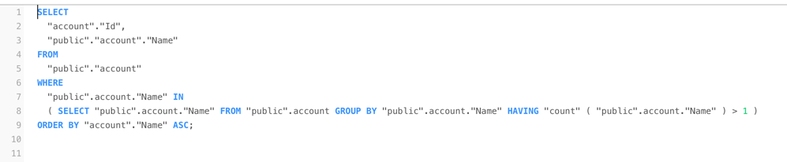
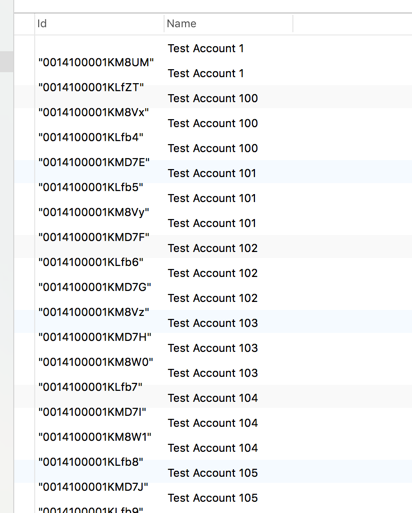

Have you ever looked at the accounts or contacts in Salesforce and said to yourself, "there are so many duplicates to clean up"? Duplicate rules have only been native to Salesforce since sometime in 2015 and that means there is a good chance that you have some unclean data in your system.

Salesforce does provide few tools to help you find duplicates, but it requires that the matching rules can find them and also an event to trigger those rules. Duplicate record sets, while useful if people report duplicates, are tricky to use when trying to look across the entire database. Using PostgreSQL to help find duplicates is an alternative method if you need to look through all the data. The main benefit of PostgreSQL over SOQL or reporting is that you can say what you want to dedupe on and see the records organized in a logical way for cleaning it up.

To get started you will need to make sure that you have installed a PostgreSQL server on your local machine and download a client of your choice. For this post, I used Navicat.

How to Dedupe your accounts based on account name:

Step 1: Export the data you want from Salesforce; be sure to include any fields you may want to use for filtering. It is better to pull more data and not need it than to pull less and need it later.

Step 2: Import the data via the client into a table, which in my case is called "account".

Step 3: Run your query on Accounts to find the exact match duplicates based on a field of your choice. In my case, I am using the name field. If you were doing this for contacts you may want to use name or email.

A brief explanation of the SQL statement above: I select the Id and the Name of account from my account table and then I asked to find the name of account inside a nested query, that looks for any record that has the same name more than once. I then order the account names in ascending order.

Result: 

One word of advice, if you want to filter the data and then pull the duplicates, make sure to do the process above in two steps. Create a view or a temporary table with the filtered down data and then run the query above or one similar utilizing the filtered table as the table in the nested query. This will save you from getting only one record of the duplicate rather than all of them.

Overall, PostgreSQL can you give you a quick and easy way to find all of your duplicate records. If you are looking for an easy and fast way to go about merging those afterward, check out my review on [Enabler4Excel (now XLConnector)](http://sf9to5.wordpress.com/2017/04/06/review-enabler4excel/).
