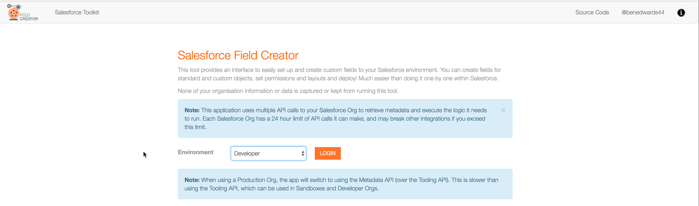
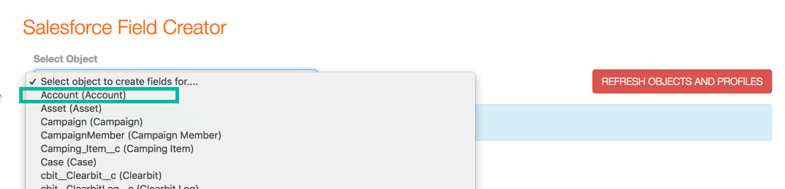
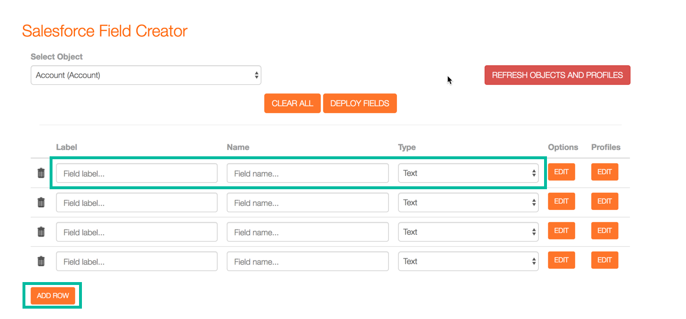
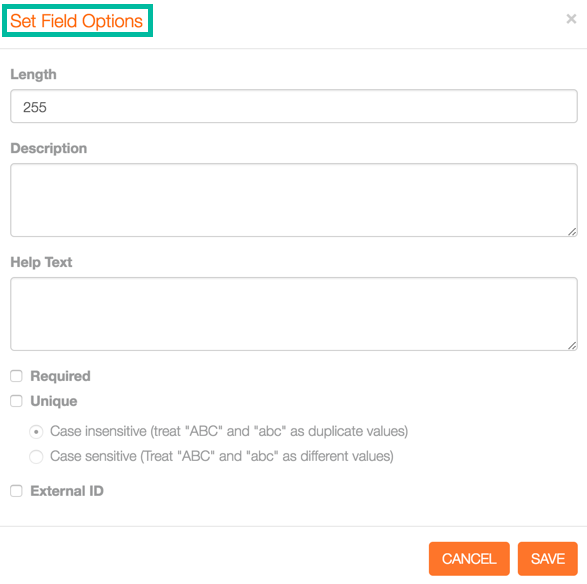
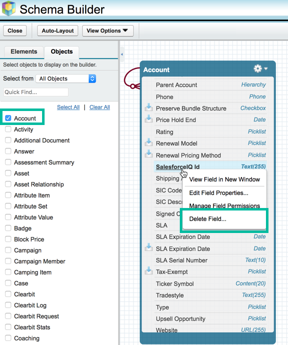

Have you ever had a request that asks for 20 new fields for two different objects? Of course, you then think, going through the standard Salesforce process is going to take forever. Well, thank goodness for apps! There is an app called Salesforce Field Creator, from the makers of the Salesforce ToolKit, that allows you to quickly make multiple fields at once.

Step 1: Go to [https://fieldcreator.herokuapp.com/](https://fieldcreator.herokuapp.com/) and login in with your choice of Production or Sandbox 

Step 2: Select the object that you want to create the fields for (once your fields are created in the next step, you can simply switch the object to create the same fields for another object) 

Step 3: Fill out the label, the API name will auto-fill unless you want it to be something specific, and select the type the field should be 

Step 4: Fill out any relevant options 

Step 5: Set your profile level permissions for the fields

Step 6: Deploy! That's it you are done!

Now on the flip side of this story, say you have a bunch of extra fields from people asking for things they said they needed and then never used. You could delete them from the object's fields page, but in my opinion that is more time consuming than this new trick I recently found out about. If you go to the Schema builder (Setup-> Schema Builder), you can find the object you want and then right-click on the field to delete it.

When you have multiple fields to delete, this can be easier because the entire page will not refresh after the fact and you do not have to scroll all back down to the fields you are working with.

 

