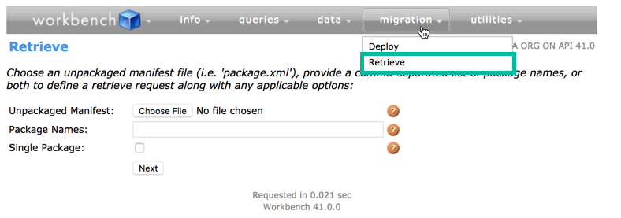
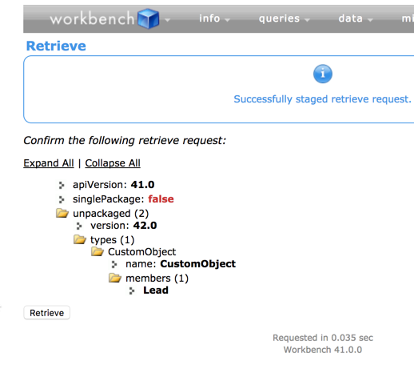
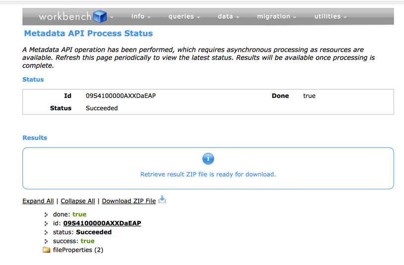
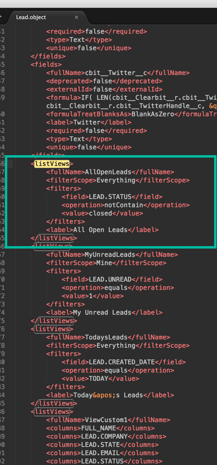

ListViews are probably one of the most ubiquitous forms of losing track of what you have already made in Salesforce. I cannot tell you the number of times I have tried looking through ListViews on an object to see if the desired outcome had already been created. In other instances, ListViews can seem to come out of nowhere especially if you allow many users the ability to create public views, and you want to be able to see how many and what they are, without too much scouring of Salesforce.

To tackle the problem of finding out what ListViews per Object you have, we turn to WorkBench. If you haven't already explored WorkBench as an admin tool, I highly recommend it, as it is quite flexible with minimum code knowledge required.

For our task at hand, I am going to do a metadata pull for the Lead object to get the list of ListViews that I have for Leads.

Step 1: Login to WorkBench

Step 2: Create your Metadata File - since we want all of the ListViews for a single object, we only need to create the package.xml file for the Lead object. Make sure to save the file before proceeding to the next step.

```
<?xml version="1.0" encoding="UTF-8"?>
<Package xmlns="http://soap.sforce.com/2006/04/metadata">
   <types>
     <members>Lead</members>
     <name>CustomObject</name>
   </types>
 <version>42.0</version>
</Package>
```

Step 3: In WorkBench go to the Migration dropdown and select Retrieve 

Step 4: Upload the file, leave everything else blank and click next

Step 5: On the next page you should see a Retrieve button, use that to get the metadata 

Step 6: Use the Download Zip link to get to the file you need. Once downloaded, you should see a folder called Object and inside that will be the xml file. You can open this in your preferred editor, or you can do XML to Excel transformation so it easily maintainable for someone who doesn't work with XML frequently.





That's it! You have now got your object's XML which contains the ListView metadata, including Name, filters, and columns. If you need metadata for a specific ListView only, you pretty much follow the steps above changing only the package.xml file. For more information about the elements and their meanings, check out:

[https://developer.salesforce.com/docs/atlas.en-us.api\_meta.meta/api\_meta/meta\_listview.htm](https://developer.salesforce.com/docs/atlas.en-us.api_meta.meta/api_meta/meta_listview.htm)
