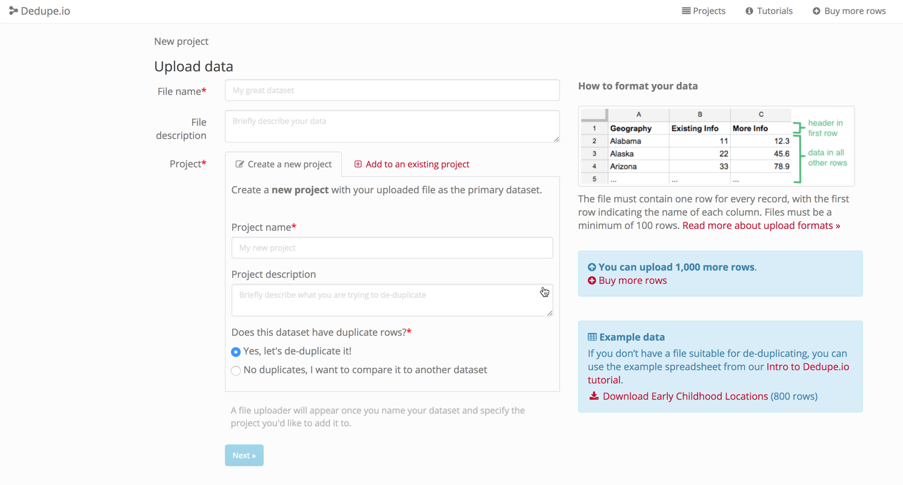

[Dedupe.io](https://github.com/dedupeio/dedupe) is an open-source Python library designed to help with finding fuzzy matches among large datasets. This type of library can be a godsend to any Salesforce admin or developer who is dealing with a large number of records and trying to dedupe them.

The cool thing about dedupe.io is that while it utilizes machine learning, it will rely on you to train it, so you'll know it is learning correctly. You will get a chance to teach it for at least 10 correct entries that you find to be match versus not a match.

Dedupe.io has several different methods that can be used ranging from free and easy to complex but free. In this post, I will provide a brief overview of each of the options.

## Option 1 - Free and Easy

Dedupe.io has an [online GUI](https://dedupe.io/) that allows you to enter your data up to 1,000 records. I think that this one is pretty straightforward so I will move on to the other options.



If you need more than 1000 records, Dedupe.io offers paid plans.

## Option 2 - Slightly Complex

If you are unfamiliar with utilizing a CLI then this may be a bit of a challenge, however, if you are a CLI wizard this should be a breeze.

In this option, you will be using a Python library developed off the dedupe library called [csvdedupe](https://github.com/dedupeio/csvdedupe). You can use this module to train the model and get the duplicate data. To use the library, you would need to provide a config file and the input dataset.

Sample config file:

```
{
 "field_names": ["Account Name", "Billing City", "Billing Country"],
 "field_definition" : [{"field": "Account Name", "type": "String", "Has Missing" : true},
 {"field": "Billing City", "type": "String", "Has Missing" : true},
 {"field": "Billing Country", "type": "String", "Has Missing" : true}],
 
 "output_file": "output.csv",
 "skip_training": false,
 "training_file": "training.json",
 "sample_size": 1500,
 "recall_weight": 2
}
```

The Github page for the library has all the information you need to create your own config file.

**One note about this option, there is presently a bug in the code and I have filed a ticket [here](https://github.com/dedupeio/csvdedupe/issues/81) with the workaround.**

## Option 3 - Most complex, but also most valuable

If you [download the examples](https://github.com/dedupeio/dedupe-examples) from the dedupe GitHub page, you will find an example called csv\_example. This one is pretty malleable and suits the purpose laid out at the beginning of the post quite well. You will need to modify the csv\_example.py file in order for it to handle your specific data and fields - but this won't be much different than if you went with Option 3. What's nice about this option is that you get both the Cluster ID and a Confidence score, which tells you how likely the pair is actually a match. In addition, the system will give you canonical fields, which is basically what it thinks is the most correct version of the dataset.

All of these options can produce a CSV file with the results. You can then use this file to help with merging or updating data in Salesforce. My recommended software for this would be [XLConnector](http://sf9to5.wordpress.com/2017/04/06/review-enabler4excel/) (previously Enabler4Excel).

If you are a Salesforce admin with developer skills, you would probably prefer to use Option #2 or #3 as it allows you to programmatically dedupe your data and integrate this functionality into larger data management projects. However, if you just need to quickly dedupe a small dataset, you would want to go with option #1.
