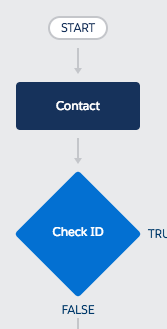
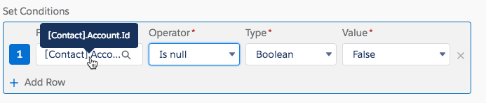

Process Builder is a fantastic tool that offers significantly more capabilities than Workflow rules. One of those abilities is handling updates or criteria points based on cross object references (up to 10 lineages away). However, if you aren't careful with the setup of this kind of flow, you may end up with unexpected flow errors. A common error as result of incorrect setup is "_The flow failed to access the value for \[example\] because it hasn't been set or assigned._"

When creating a decision point (represented by the triangle) in the Process Builder and calling out to a related object, you must first check that the lookup field is NOT blank. You would do this by selecting the Id field of the object you are reaching out to and setting it ISNULL Boolean FALSE.

It is also worth noting that you must have the check on the ID as the first criterion in the list when you are checking multiple items; without doing this there is still a good chance that you will receive the error message noted above.

As simple as this may seem, this small change is an easy one to miss when creating Process Builders and even more easy to miss in testing if you don't cover all of the use cases.

If you would like more information you can check out the knowledge article on the error message here: [https://help.salesforce.com/articleView?id=000212174&language=en\_US&type=1](<http://knowledge article>)
