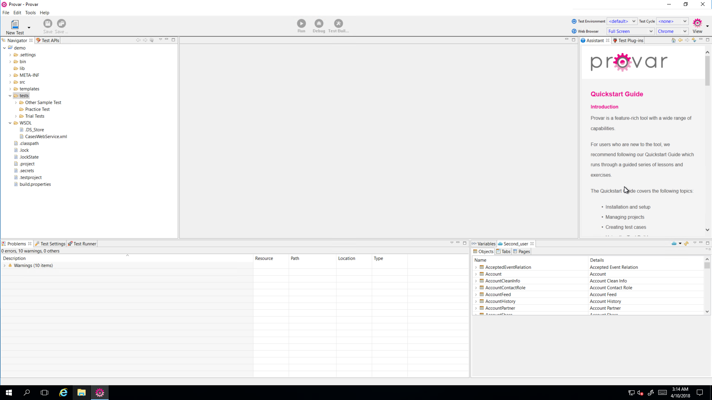
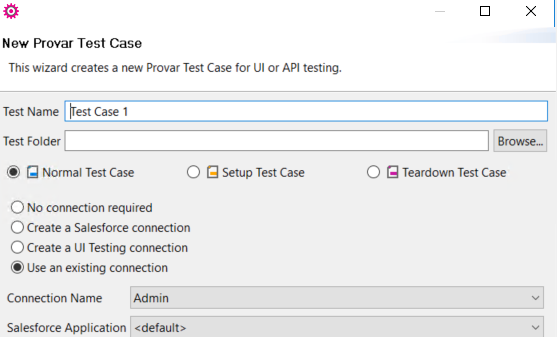
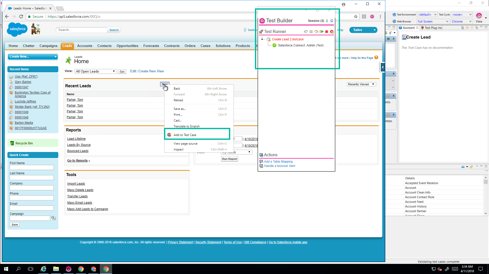
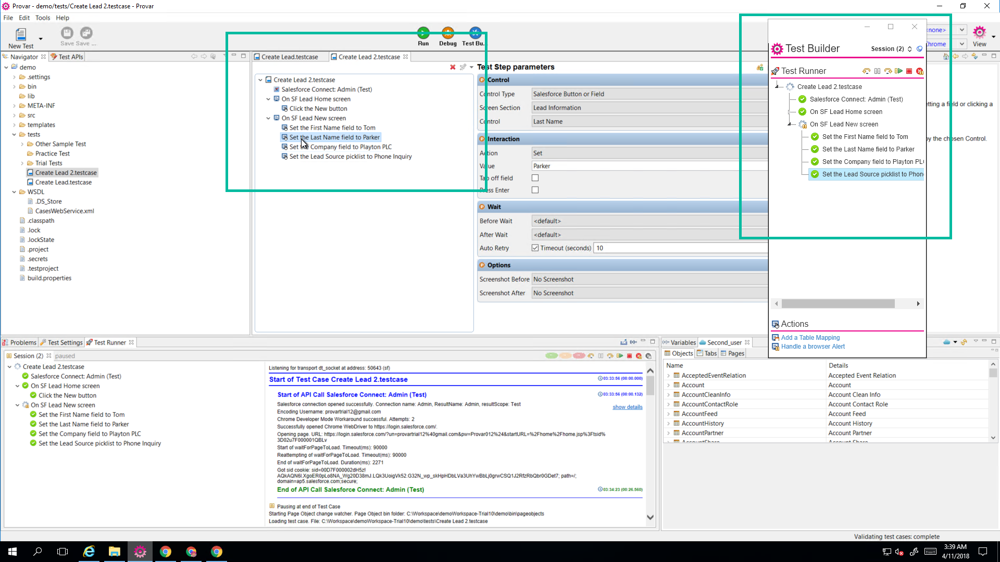
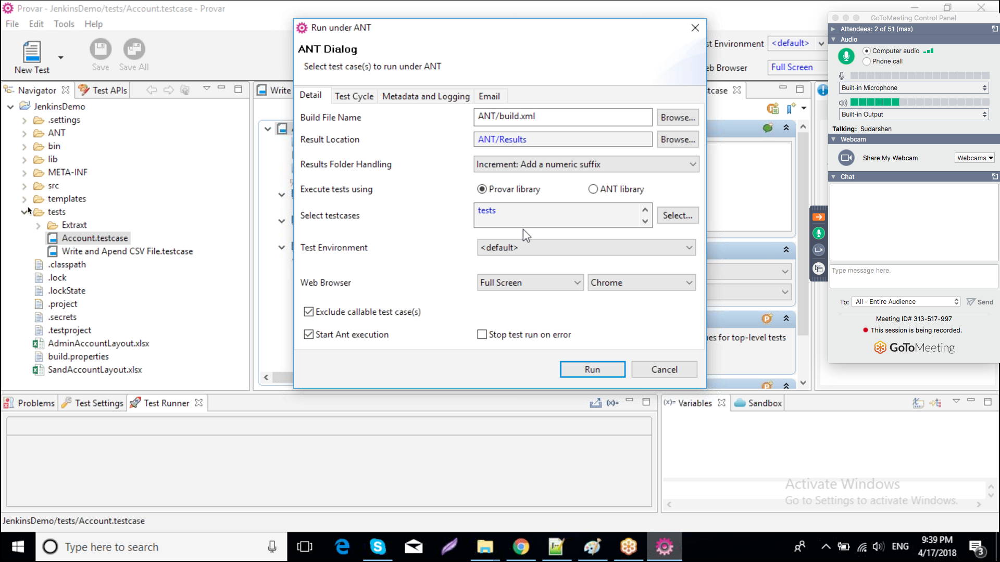
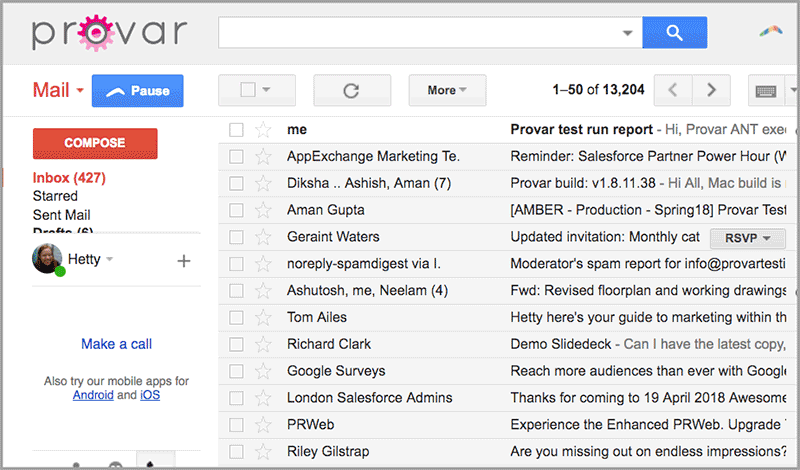
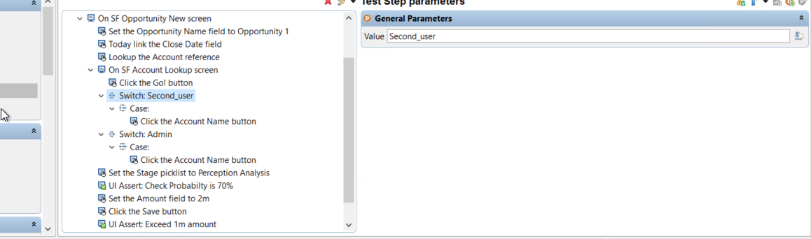

Not too long ago I came across a tool called Provar on [SalesforceBen's](http://www.salesforceben.com/all-you-need-to-know-about-salesforce-development-best-practices-in-one-post/) site. [Provar](https://provartesting.com/) is an automation testing system designed just for Salesforce. It is built on top of [Selenium](https://www.seleniumhq.org/) and it is completely point-and-click for setting up the tests, which is a great feature for teams who do not have anyone with QA development skills or the time to write them.

I reached out to [Provar](https://provartesting.com/) directly in hopes of being able to try out the system personally to understand its benefits and get a feel for how it works. They were very responsive and more than willing to give me a trial. I did participate in a slightly different style trial than they would do with someone who is buying the software - they set me up on a virtual machine to try it out. Provar is an installed application, not cloud-based, so this made it easier for me to give it a spin.

\[caption id="attachment\_2286" align="alignnone" width="1920"\] Basic Welcome Screen\[/caption\]

After an initial demo call, I was put in touch with a trainer who would be able to assist me throughout the trial with any questions I may have. They also provided me with their quick start guide which includes many tutorials for using the software.

During my trial, I did reach a few times with questions or scenarios that I thought would be most applicable to the system, for example being able to run a single test as multiple users. To ensure a complete understanding, they were very accommodating to my off hours and scheduled to meet with me twice to go through my questions and the general features of Provar.

Here is an example of setting up a very simple test in Provar.

Part of Provar in addition to the installed application is a Chrome Extension, which is their Test Builder. This is the tool that captures the different steps in the test to compile together into one.

Step 1 - Create a New Test

\[caption id="attachment\_2285" align="aligncenter" width="557"\] Create a New Test\[/caption\]

Step 2 - For each step in the test you create, say creating an Account, you simply need to right click on the step before you do it and click, Add to Test Case. The Test Builder will then provide you the options for anything that needs changing.

Step 3 - Repeat the above step for every step in your test, including validation rule alerts, popup message, and clicking on buttons. When you are done you will be able to see in Provar all the steps that you added and make any necessary modifications.

Step 4 - Save and either run now or run later or add it to a scheduled test.

## The Nuts and Bolts of it

Provar is the complete package for testing automation for Salesforce. It has everything one could need to create any kind of test script, including custom coded scripts.

### Pros:

- Point and click based system that does not require any coding
- The ability to create regressional testing cases and run them using ANT, Jenkins, etc.
    - 
    - You can also get reports of the results emailed to you
    - 
- Create scenarios that replicate different user stories and patterns
    - I.e. A validation rule that should only show up for one profile, but not another
    - \[caption id="attachment\_2280" align="alignnone" width="1158"\] Switching between users in a single test\[/caption\]
- The ability to test through API and through the UI
- Running test in different environments, Sandbox vs Production
- Support of both Lightning and Classic
- Support for CPQ (although there are some technical complexities)
- A very helpful support team and staff

### Cons:

- There is a learning curve to the software even though it is point-and-click, in terms of understanding the very large number of functionalities offered and the various ways to do things
- There is a time commitment that you need to make if you are going to use this, as the baseline of tests will take time to create

## My overall opinion

As someone who typically has worked on very small teams with minimum resources, I was very excited to try [Provar](https://provartesting.com/) out. I think it is an excellent tool that can help any team with their regressional testing for Salesforce. However, I think that it is more designed for teams with QA or someone who can spend dedicated time on setting up and maintaining the tests. The reason I say this is, the tests themselves can get complex very quickly, especially if you are in a large enterprise org with many different functionalities.

To take true benefit and maximize the product, you need the time to create the baseline of tests, which could easily be in the 100s and then for each new feature you should be creating new tests. Provar has extremely good potential for teams that have the resources to maintain it and the mind to understand the benefits it can give.
