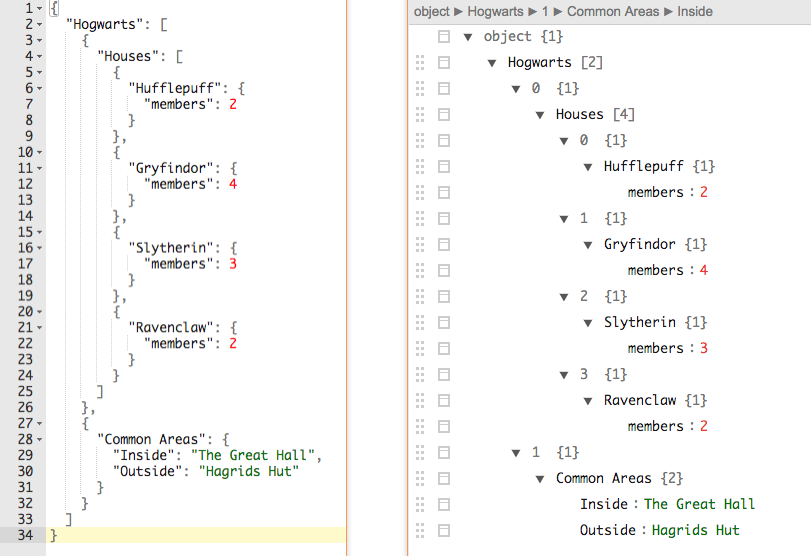
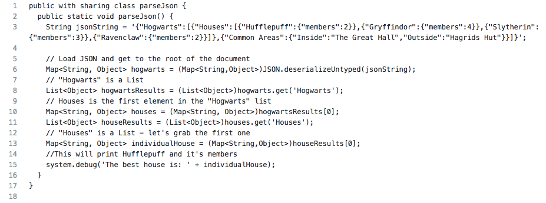

One of the things I am learning through my journey to becoming a DevAdmin is how to parse JSON. Understanding how to parse JSON is one of those absolutely necessary skills to have when learning APEX. The reason is that JSON has become one of the standard ways of delivering or receiving data. Most likely, any interaction Salesforce might have with an outside API or web service would either need to send or receive a JSON response.

To explain how to parse JSON I decided to build a response that is based off my favorite book series, Harry Potter. So, to begin here is the JSON response in its pretty format:

To demonstrate how to parse the above JSON I am going to look for and print what I consider to be the best house of them all, Hufflepuff and it's members.

Before jumping into the code, I'd like to explain a quick tip that would help you parse any JSON response. The squiggly ("curly") bracket "**{**" represents a [MAP](https://developer.salesforce.com/docs/atlas.en-us.apexcode.meta/apexcode/apex_methods_system_map.htm) in APEX and the square one "**\[**" represents a [LIST](https://developer.salesforce.com/docs/atlas.en-us.apexcode.meta/apexcode/apex_methods_system_list.htm). You may need to traverse from map to list to map in order to get the level that you want. For each level, you will also need to do [casting](https://developer.salesforce.com/docs/atlas.en-us.apexcode.meta/apexcode/apex_classes_casting.htm). Casting is the action of converting one data type to another, which you will do each time you move from MAP to List or List to MAP.

Here is a link to the Gist:  [https://gist.github.com/ysfdc/d645f574818e5dad5f7c1bbc7eb24e24](https://gist.github.com/ysfdc/d645f574818e5dad5f7c1bbc7eb24e24)

In my class, I first set my JSON value to a string as preparation. In many cases, though you will receive JSON through an HTTP response.

After setting the **jsonString**, I am then able to deserialize the JSON and parse the root structure into a Map (_line 6_). Once I have the initial Map, I have access to the first list, which is **Hogwarts**. Inside that list (remember the "\[") are two more elements, **Houses** and **Common Areas**, which can be accessed by defining a map for each. Since I want to access the **Houses** element, I create a Map based on the first result in the Hogwarts list (_line 10_). From here I could access any of the houses and their members by setting the **individualHouse** Map to whichever index of the house I want. Since I am a proud Hufflepuff and that is the first element in the Houses list, I set **individualHouse** to **houseResults\[0\]** (_line 13_). I then go on to print that this is the best house in the debug logs for good measure.

Overall the concept of parsing JSON is pretty straightforward and should be looked at through a series of Maps and Lists as you traverse through the JSON response. Each JSON response will look different from the next, but if you remember the handy trick I noted above to know when to use a Map versus a List you should be good to go! And always remember to cast!
