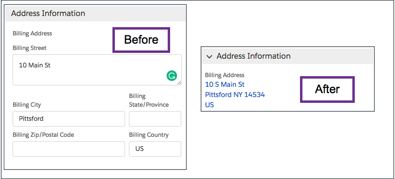

As part of my DevAdmin journey, I recently developed a tool that you can use to help normalize and clean up your billing address fields in Salesforce.

Several months ago I embargoed on a project for a client to do some heavy data cleanup, which included normalizing addresses and deduping accounts. During that process, I learned the human inputted addresses can NEVER be trusted.

In thinking about a way to solve this issue, which no matter what way you look at it, in most cases a human, or possibly a 3rd party system is going to be putting the addresses into Salesforce. Those addresses may be inconsistently formatted, missing data, or just straight up wrong. Now, I couldn't come up with a solution for the straight up wrong addresses, but I did come up with something that can help with missing data and misformatted data.

Introducing, the [Address Normalizer](https://github.com/ysfdc/AddressNormalizer). This set of APEX classes is designed in a way to just allow you to plug-and-play (baring you have the necessary licensing from Google). The tool consists of two classes that work the [Google Maps API](https://developers.google.com/maps/documentation/geocoding/start), taking any newly added or updated address, sending it out to the API and then updating the address fields in Salesforce based on the returned response.

To access the tool and the readme please check it out here: [https://github.com/ysfdc/AddressNormalizer](https://github.com/ysfdc/AddressNormalizer)

Now for some more technical details about the classes and why some things are the way they are.

Before jumping in, here are a couple things I learned why compiling this:

- You cannot make future calls from a Trigger, or even from the TriggerHandler
- You cannot use the BillingAddress compound field in anything other than a query
- You cannot pass an Object to a future class
- Google Maps API does not support batching

_**AcctTriggerHandler**_

This class handles the basic functionality of mapping the old and new values from the trigger with their corresponding IDs. It then pairs down those Accounts to get just the ones we want to pass through to the GoogleMapsCallout class since we don't want to use more calls to the class that is necessary. To get the right set of Accounts, the class checks if the Address is Null and to make sure that Old and New do not match each other. It then calls the GoogleMapsCallout class, passing the Id and Address. This is done in a for-loop because the Google API does not support batch processing.

_**GoogleMapsCallout**_

This class does quite a lot in it 100+ lines of code. However, first you need to do two things: 1) get a Google API key and input into the file in the APIKey variable, otherwise, this tool will not work. 2) You need to understand what isStrictMode is and decide if you want it on or off. By default, it is on to prevent any unnecessary mishaps. To learn more about isStrictMode, check out the ReadMe file.

Once those decisions are out of the way, you are good to go.

So how does this class work? First, the future method, getGoogleGeo, creates a new HTTP request out to the Google Maps API for each account and Id pairing that is passed to it.

After the request to the API is made, the fun of parsing the JSON response back from Google begins. Since the response (which can be found here) is fairly consistent, I went the route of breaking it down myself rather than dealing with a wrapper class that would be longer than this whole project. From the JSON I specifically pull the individual components of the address (street number, street name, city, state, country, and postal code) and store them in an instance of the GeoProps class.

Once the GeoProps class is built, the instance of it and the Account Id that goes with it is sent to the updateAcctAddress method. This method handles the parsing of the fields to put the correct data into the correct fields in Salesforce. It is here that the isStrictMode will have the most impact, as depending on what you had previously set it to, is how much of the data will be overridden when the update acct command is fired.

**Testing**

I ran several different scenarios to ensure that I caught as many fluctuations and variations of the data that I could. Doing these tests is what also led me to create the isStrictMode, as I did not want to accidentally override half decent data with completely wrong data.

Here are some of the test cases I used:

- Somewhere (street) GB (country)
- unknown (street) Perth (city) WA (state) AU (country)
- Perth (state) AUS (country)
- A full local address in NY (all fields filled out but with abbreviations)
- Just the state - NY
- Just the country - US
- Just the zip code 14534
- The entire address written in the street field
- Just a street name, once with a number and once with no number

I also tested this process in batch. I updated some 50+ records at once with no issues. The main reason this works is that each address is being individually submitted to Google and it is taking place as a future call.

I highly recommend you do some individualized testing with this in a sandbox to make sure that the settings work right for you and your organization. Keep in mind since the data is human inputted no data response back can be correct 100% of the time. The goal of this tool is to help normalize the addresses of accounts, making it easier to report on and to keep track of duplicates.

GitHub Link: [https://github.com/ysfdc/AddressNormalizer](https://github.com/ysfdc/AddressNormalizer)
