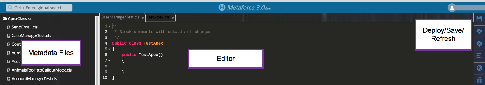
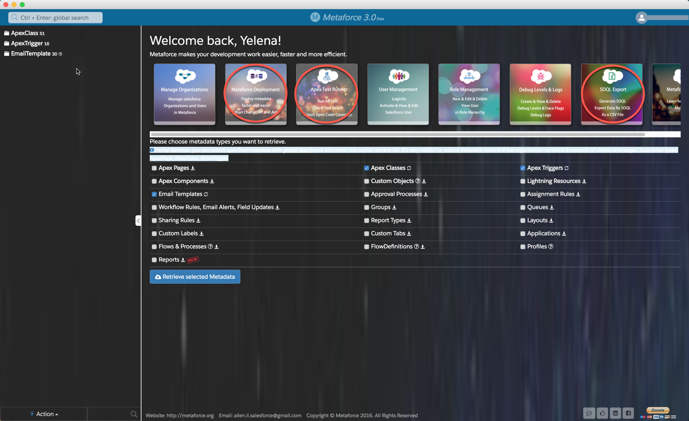
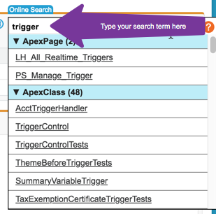
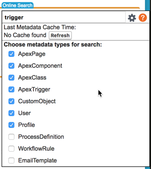

One of the search functionalities that are missing from Salesforce is the ability to search anything APEX-related by the name of the class, page, or trigger. As someone who always looks for more quick and simple free tools to use in conjunction with Salesforce, I stumbled upon [Metaforce](https://chrome.google.com/webstore/detail/metaforce/hhnkaakhlhngcdckdiogpkjihnmgodep?hl=en).

Metaforce is a multi-faceted tool that has two main components to it: an application that can be used for writing and deploying code and a chrome extension that helps you search within Salesforce.

## The Metaforce App

The App itself looks like an external application but is actually a Chrome application which I like since I rarely leave my browser.

The functionalities of the app that I find useful are the editor and the quick deployment and the metadata retrieval. If you have ever used [MavensMate](http://sf9to5.wordpress.com/2017/05/17/development-mavensmate/), this tool functions very similarly to it but is all web-based.

If you pop around the main screen of the app you will also find some other tools for running SOQL queries and exports, and the ability to run your test classes. There are other tools as well, but I found them of less benefit.

## The Chrome Extension

This extension has been an absolute lifesaver! Since I am not the one primarily creating the classes in our environment, I have always wanted the ability to search by a keyword that I would assume would be in the name of a class. Salesforce's Search in Setup does not provide this type of functionality, but the Chrome extension for Metaforce does! And it really is super simple. A little looking-glass icon appears on your screen as soon as the extension is installed and you have done the initial login. After that, from any page inside Salesforce, you can search.

You can also define what types of metadata to include in your search to either expand or reduce the number of options you get. You can then right-click on your result to open a new tab so you don't even lose what you are on. So many clicks are saved by this tool!

Overall I give the Metaforce App and Chrome Extension an A and big thank you for saving me a lot of time and effort finding things!
