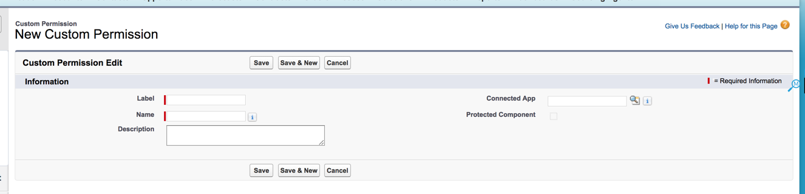
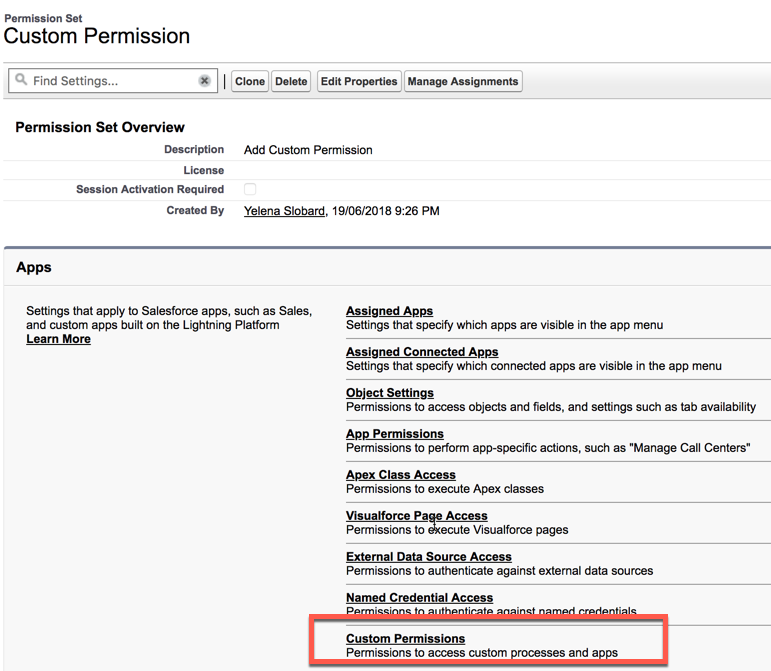
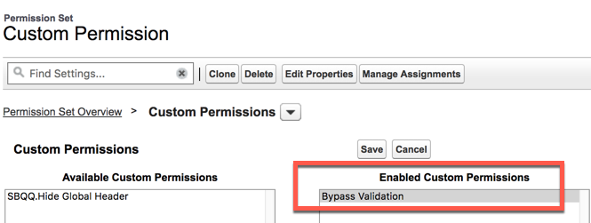
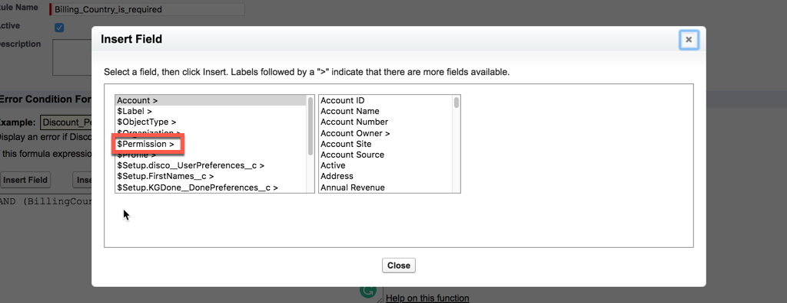

One of the many best practices that Salesforce has is to avoid hard-coding things like IDs because the maintenance of them can become impossible and they can be something easily forgotten (if you're a developer, you'd know that hard-coding is a big No-No).

Validation rules are one of the places where hard-coding IDs, especially for users, can be a very common thing. While at TrailheaDX I learned a nifty trick to get around this using Custom Permissions. If you're not familiar with Custom permissions, they are similar to Permission Sets in the sense that you can use them to check if a user has the necessary access or permissions.

In our use case, we are going to use this feature as a means of allowing a user or group of users with the Custom Permission to bypass a validation rule, instead of using the user IDs in the validation rule itself. For the validation rule, I'm going to force Billing Country to be populated on an Account.

1. Go to Setup -> Develop -> Custom Permissions and click New 
2. Give a name to your Custom Permission ('Bypass Validation') and save
3. The next step is to assign the Custom Permission to a Permission Set
    1. The Permission Set is the intermediary piece that will allow us to assign the Custom Permission directly to a user. If you want to do this at the profile level, you can assign the Custom Permission directly to the profile. 
    2. Once you created the Permission Set - assign that to the Users you want to bypass the validation rule
4. Next, it is time to update your Validation Rule. Using the Insert field button, go to the Permissions options and select the correct Custom Permission  In my example, the rule would look like this (read as: require Billing Country for all users who do not have the Bypass Validation Custom Permission): **AND(ISBLANK(BillingCountry), NOT($Permission.Bypass\_Validation))**

That's it!! You can now use that same permission set based on the certain groups of users that you may consistently need to bypass validation rules.
