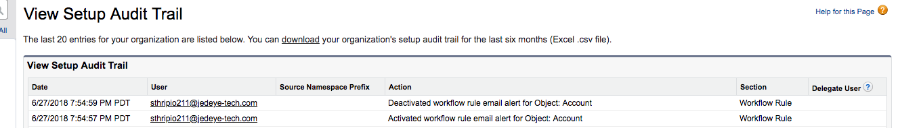
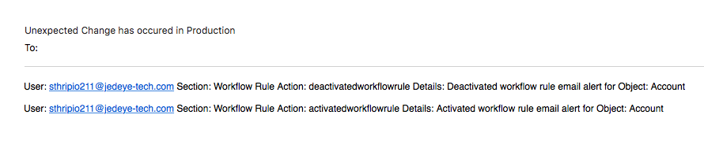

In one of the Salesforce orgs that I work on, there are many users who have the System Administrator profile. While this is not a best practice, especially when they are not all actually admins, the need for those folks to have that profile does exist. When you have a lot of people with those types of permissions, things are bound to go awry or simply happen without your knowledge.

Recently, I started to notice that changes were happening in my Production org and I was unaware of them (I typically find these things out when a user reports a bug and I stumble upon another's work). Up until now my only means of monitoring the changes has been to consistently download the change log from the Audit Trail in Salesforce. This process is very tedious and time-consuming as I always have to filter down to see exactly who or what I am looking for.

As a result of my pain in doing this process, I set out to find a more programmatic and automatic solution (after all, I'm transitioning from Admin to DevAdmin). My research yielded in [AuditLogScanner](https://github.com/ysfdc/AuditLogScanner) - a tool which I created to solve the problem.

AuditLogScanner does pretty much what it says it does. It scans the Salesforce Audit Trail records based on a certain set of criteria (in the form of a SOQL statement), and when something is matched, it sends me an email with the details. The best part about the tool is that it is designed to run as a [Scheduled APEX (Cron Job)](https://developer.salesforce.com/docs/atlas.en-us.apexcode.meta/apexcode/apex_scheduler.htm), so I can set it to run every hour and I can always stay up-to-date in near real-time on any changes going on in the Org.

\[caption id="attachment\_2331" align="aligncenter" width="890"\] Copy of the Email notification\[/caption\]

Alright now for the more technical bits behind AuditLogScanner (and as always it's open source).

GitHub Project here: [https://github.com/ysfdc/AuditLogScanner](https://github.com/ysfdc/AuditLogScanner)

_**auditLogScanner**_

This class handles all of the major functionality of the tool. It has two methods in it, parseAuditLogs and sendEmailMessage. The parseAuditLogs method has a SOQL query that runs on the SetupAuditTrail object. There are a couple of class members that help make the query work:

- **lookbackHoursPeriod:** the numbers of hours you want to look back over
- **usersToMonitor:**  these are the usernames to filter down to, in the case that you do not want to monitor and get emails for everyone in the system
- **ignoresections:** while not part of the query directly (you cannot filter Sections in SOQL), this is what you will use to filter out any unnecessary Sections, like updating passwords or profiles, which is the Manage Users section. To know what Sections are available, just look at the headers in the left-hand panel in Setup

After the query has run and assuming data was found, that information is then passed to the sendEmailMessage method. In this method, a Single Email Message is constructed based on the passed information. In this method, the other two global parameters are used.

- **sendEmailto**: these are the Salesforce User Ids of the people who want to receive the email notifications
- **emailSubject**: this is a static string to set the subject line of the email

The frequency in which you receive the email is based on how you construct the Cron job.

_**auditLogScannerCron**_

This is the scheduable class that invokes the auditLogScanner class. Since I am not using a trigger to jumpstart my scheduled apex, I used the Execute Anonymous in the Developer Console and a simple system.schedule call to get it running. See example:

System.schedule('Scheduled Job 1', '0 0 \* \* \* ?', new auditLogScannerCron ());

If you do choose to go the trigger route, make sure that you are not going to cause the job to run too many times in conjunction with any other scheduled jobs you may have. To see more about scheduled jobs governor limits, click [here](https://developer.salesforce.com/docs/atlas.en-us.apexcode.meta/apexcode/apex_scheduler.htm).

While this class was designed with my specific use case in mind, I believe with the way it has been structured it should be easily malleable to implement in your own org to help you with your monitoring of metadata changes (e.g. connect it with Twillio or PagerDuty if you have a 24x7 DevOps team). If you have any questions or would like a customized version of this class built for your use case, please reach out to [yelena@sf9to5.com](mailto:yelena@sf9to5.com).

GitHub Project here: [https://github.com/ysfdc/AuditLogScanner](https://github.com/ysfdc/AuditLogScanner)
