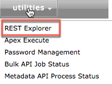
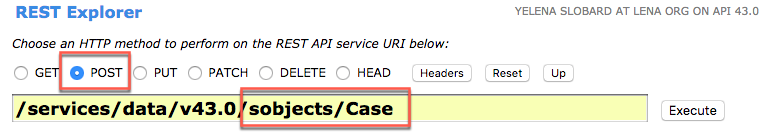
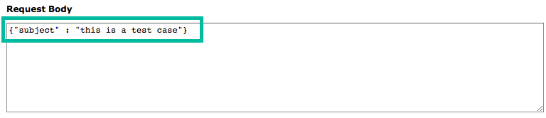

Have you ever created a new flow and the only way to test the flow was to repeatedly create records? I have done this so many times that it could make my head spin. Luckily enough, Workbench can make creating test records really simple and typically don't require as many fields as you would have to do as an end user in the UI.

For example, say you have a new set of workflows that run every time a case is created. To test the flows, you simply need to create a minimal case with the relevant field(s) that trips the workflow rules.

To do this in Workbench is quite simple:

1. Go to [https://workbench.developerforce.com](https://workbench.developerforce.com) and log in with either your production or sandbox credentials (more likely the latter since we are doing tests here :) )
2. Click on Utilities 
3. Click on Rest Explorer - In case you are wondering what exactly we are doing here, we are going to execute a simple, code-free, API call to the SFDC instance that you are logged into. This will allow you to create records at a relatively quick pace.
4. Since we want to create records, we are going to select POST as our type of request
5. We will then want to set the "URI" to direct Salesforce to objects and then the object of our choosing, in this case, Cases (see image above)
6. You could create a completely blank Case, but more than likely that won't suit your needs. So you will need to create the JSON body, which is what populate the Case fields. If you don't care about your data repeating, you will only need to do this once.
7. To create the body use the following syntax:
    
    ```
    { "API field name goes here" : "text, picklist value, boolean goes here",
    "Another API field name goes here" : "information for that field here }
    ```
    
    You can repeat that for as many fields as you need to populate.
8. Now you click Execute. As long as it works, you will get the Id of the new record you created.
    1. Some errors you may encounter include: not following the syntax above, incorrect API name, or bad permissions.
9. Now if you want to use the same data to create another record, you just click Execute again. Simple as that! No repeat processing in the UI that can eat up all of your time.

Hope you found that helpful and time-saving! And be sure to check out my other post on using [Workbench to help get a list of your Listviews.](http://sf9to5.wordpress.com/2018/02/20/how-to-full-list-listviews/)
