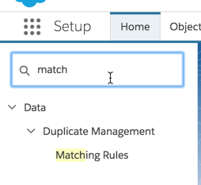
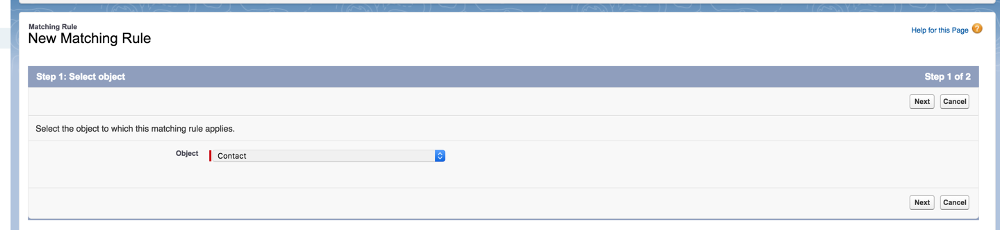
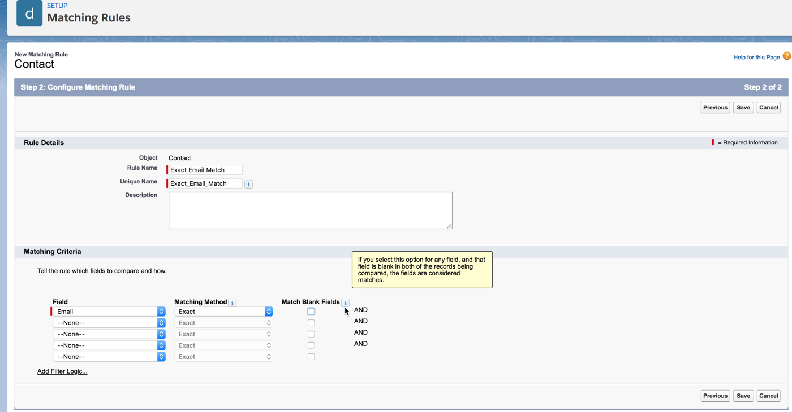

So you have been tasked with finding the duplicates in your Salesforce instance and you are trying to figure out where to start. Well, before you go to all of the different products out there, let me have you take a breath, and be happy as Salesforce has finally provided a way to find Duplicates in the system in mass.

As of the Spring 18 release, a feature called [Duplicate Jobs](https://help.salesforce.com/articleView?id=duplicate_jobs_run_and_manage.htm&type=5) was added to the Lightning Experience. If you are still in Classic, you CAN use this, you will just need to toggle on the LEX for your profile for the time being.

1. In Lightning, go to Setup and search for Matching rules
2. To allow the Duplicate job to run, you will need to create a Matching rule to set the criteria of how to tell the system to know that there is a duplicate - what to match on essentially.
    1. Click on the New button 
    2. Select your object. I am going to use Contact as my sample for this run through. 
    3. There is quite a bit of detail and thought that can be put into the rule itself. For the sake of this example, I am doing an exact match on just the Email address. This means that the Email field will be the only field used in the comparison process. 
    4. Click Activate and wait to receive an email that the rule is active before proceeding to the next step
3. In the search bar look for Duplicate Jobs
4. Select New and then fill out the form.
    1. Select the object that you made your Matching rule on - in our case Contact
    2. Select the Matching Rule you created
    3. Click Run - you will receive an email when this is done. Depending on the number of records you are running over, this can take up to several hours.
5. When the job is done running, you can go back to the Duplicate Jobs page and you will see it as the topmost executed job. You will be able to see the number of records looked at and the number of sets (the pair of duplicates) that were found.
6. The easiest way to then pair through this information is to run a report on duplicate sets. In the report, ensure to include Set Count > 1 as the Duplicate Jobs will sometimes create a duplicate record set that contains just one record, and that is not useful for locating duplicates. Also, make sure to include the Duplicate Record Set ID as this is your unique ID for the pair.
7. You now have an exportable set of data of the duplicates based on criteria that you see as duplicates. If you need a way to mass merge, I recommend using [XLConnector](http://sf9to5.wordpress.com/2017/04/06/review-enabler4excel/) (previously Enabler 4 Excel).
