Recently, I was asked how to create a bundle product in CPQ. Before I dive into the how I first want to explain the what and the why.

Many companies have products that may have accessories, add-ons, or different components that make up a product - think about purchasing a laptop and the various configurations and accessories that you would use to build that. When a company has such a product, they are likely to want to use Bundles in CPQ. Bundles allow the Sales rep to be able to see everything related to that one item in a single view and can also allow the admin to set restrictions or requirements on how that product is constructed. A Bundle essentially is the collection of options and/or components that make up a product.

For my how-to guide today, I am not using any descriptions and really not getting into all of the nitty-gritty that can be done with bundles. For each company and their product structures, the overall feel of a bundle product can be different. If you have any specific questions, feel free to email me or comment below.

1. Make sure that before proceeding you have CPQ installed. This process will not work with just the standard objects
2. Go to the Products tab
3. Click the New button. Call the Product as you see fit, I am calling mine Bundle Product - for now, I am not filling anything else out on this screen. 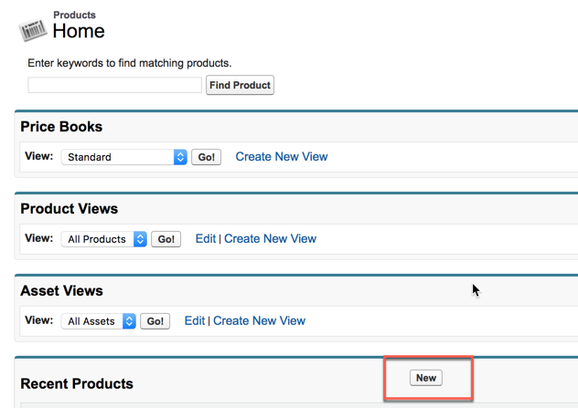
4. Click the Save & Add Price button. For my sample bundle product, I am making it $0 as the cost will be made up of the parts. This will vary based on your business case. 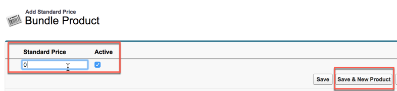
5. Create some additional products that will be the products that make up your bundle. Even if your "products" are not really Products but you want them to appear as selectable components or options in the editor, you will need to then add them as a Product. We will use this in a later step.
6. Make sure that all of your Products, including the Bundle product, have a Price Book Entry - this is critical as without the Products will not show up in the configurator. 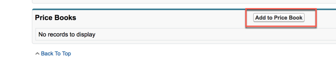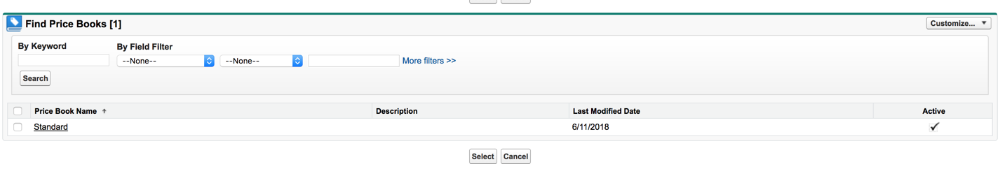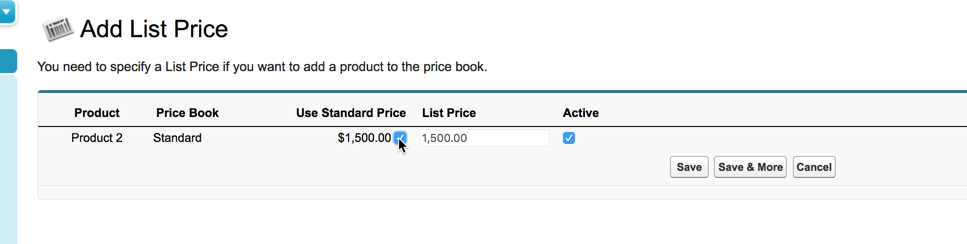
7. On the Bundle Product, scroll down to the Product Options related list and click New Option. 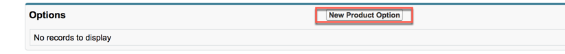
    1. Here you will want to give a Number, which is the sorting order value and then select the Optional SKU - this will be those secondary Products you created in Step 5. 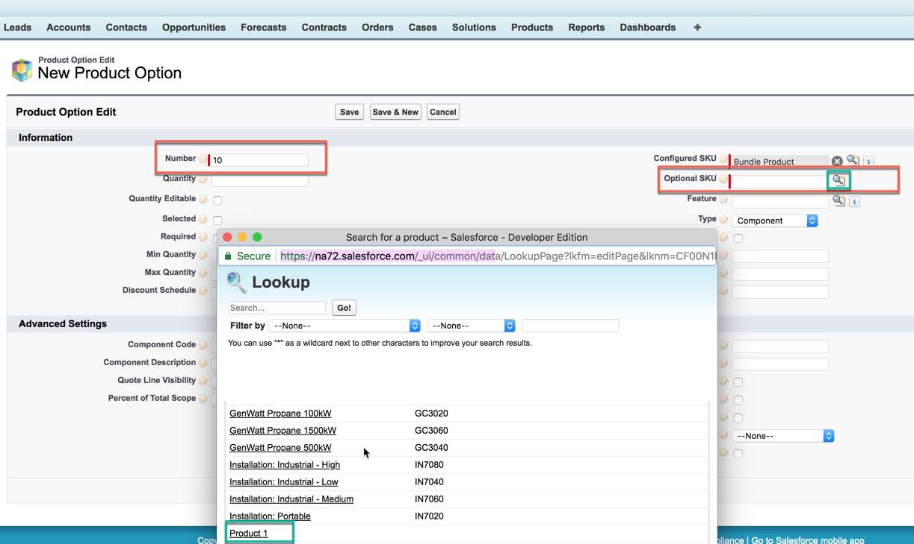
8. If you want your users to only see the Bundle Product and not the products underneath that, then on each of the Products you created in Step 5, mark the Component field as TRUE. 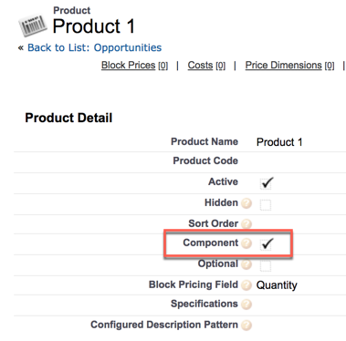
9. On the Bundle Product field set the following fields: Configuration Type, Configuration Event, and Option Layout. These will drive how and when your user can see and modify the products, including how the Options will appear. 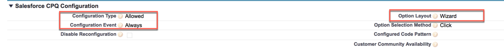
10. Finally, you are ready to test. Open a Quote and do Edit Lines - select your Bundle Product.
     1. Here you will see the Options that you placed under the Bundle Product. 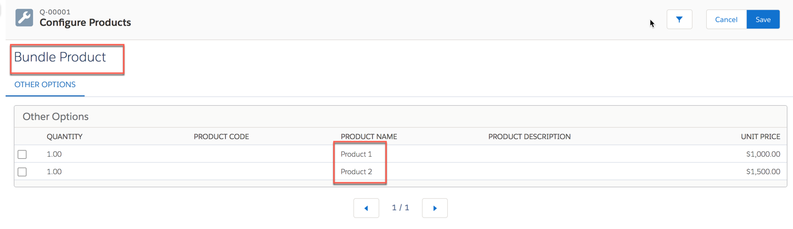
     2. You can then Save the configuration and see what it looks like as a package in the Quote Line Editor. 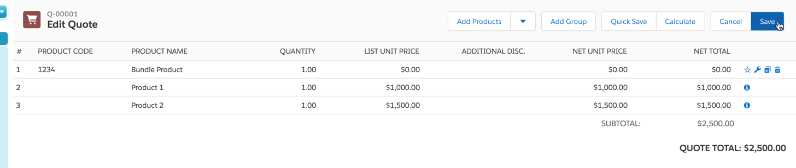
11. Additionally, there are things you can do with the Bundles in the Quote Template, but I will leave that to someone to request, hopefully with a scenario in mind.

P.S. For all of you learning how to use CPQ, it is your lucky day, besides my [study guide](http://sf9to5.wordpress.com/2017/09/12/salesforce-cpq-exam-study-guide/), Trailhead now has a [CPQ module](https://trailhead.salesforce.com/trails/cpq-admin) that is based on the Steelbrick package rather than the built-in objects.
