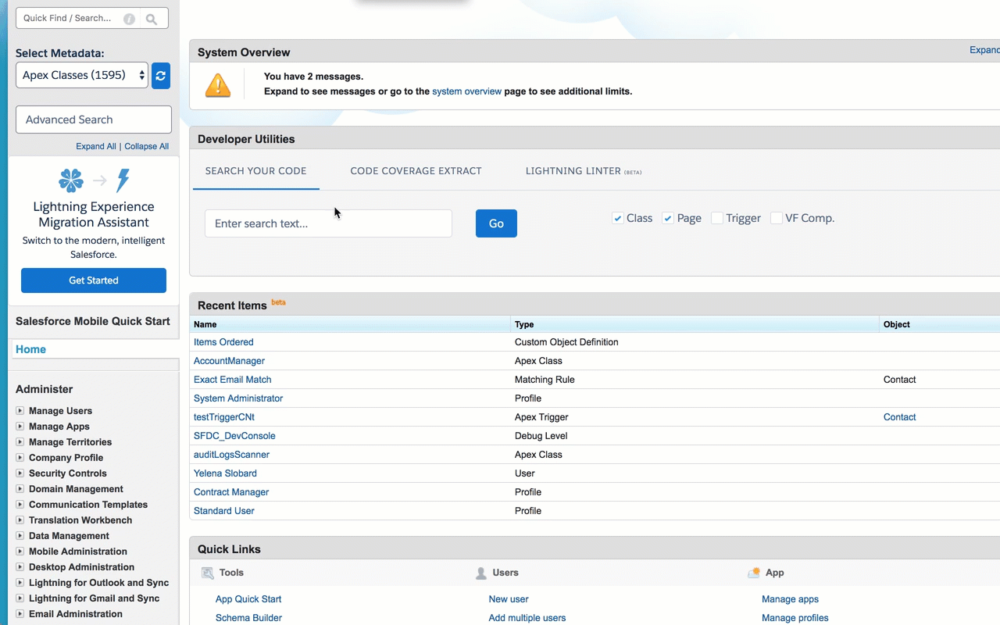

One of the things that always irked me about the Salesforce Setup was the lack of ability to search the code in the system. Previously, as a first step (so to speak), I found the tool [Metaforce](http://sf9to5.wordpress.com/2018/06/13/review-metaforce/), which allows you to search based on the name of workflow, email templates, and apex classes - but you have to know the name.

Recently, however, I was on a call with a Salesforce developer, who was still in Classic and I was able to see one of the tools he was using, which looked to be called Developer Utilities. Luckily for us all, this is not some proprietary tool that is only for Salesforce, but rather a Chrome Plugin that is accessible to all! The formal name of the tool is "[Salesforce Advance Code Searcher](https://chrome.google.com/webstore/detail/salesforce-advanced-code/lnkgcmpjkkkeffambkllliefdpjdklmi/related?hl=en)".

Basically, the tool does exactly what the name says it will do. You can search your code by words inside the code, for example:

I looked for the word Contact and it brought up all of the different classes that contained it. It allows you to search through Classes, Triggers, Pages, and VisualForce components.

Once you have run the initial search, the tool lets you filter further by the Name and the Type (your type options will vary based on what you initially chose to look for).

From there you just click on the class/page that you want and you are off running!

The second search that this tool provides is an advanced search that allows you to search for Custom Objects, Email Templates, Workflow Rules, etc. My favorite so far is the Custom Object since I can look for the name and it auto searches and I can just click right to the object, no multiple clicks required. This portion of the tool has much more relevance in Classic (and may be why the tool is ONLY in Classic) as the search mechanisms are very different between the two design systems.

Overall, if you are still in Classic, this is a definite must! It will save you so much time and so many clicks. If you are not in Classic, but still need to search code (you don't use a repository, etc) then I recommend you install this plugin and switch over to Classic (while you still can) and save yourself from digging for what you are looking for. I also hold out hope that the developer of this tool will create a Lightning friendly version.
