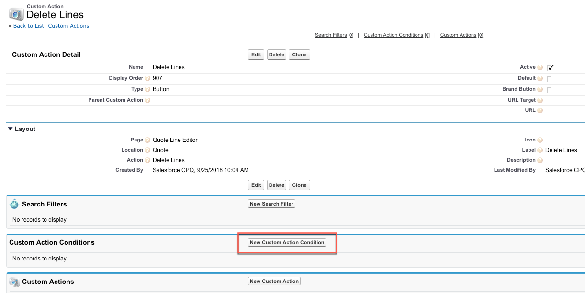
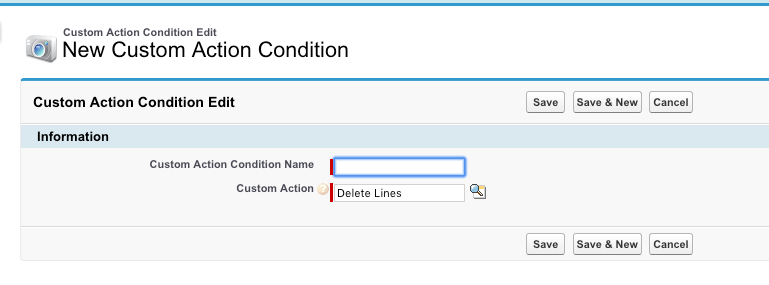
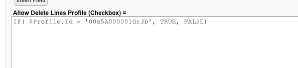
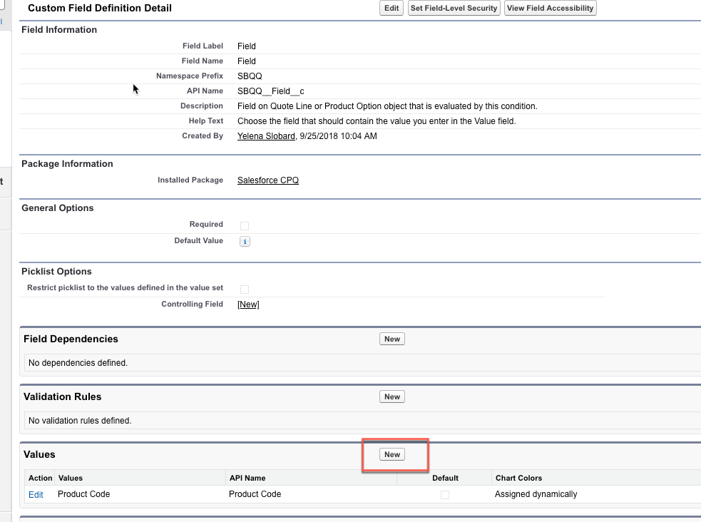
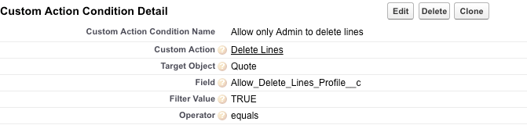
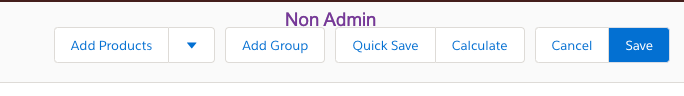
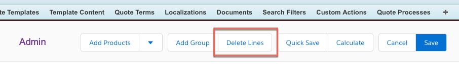

Say that you have created a custom action button for the quote line editor in Salesforce, or that you only want certain users to have access to certain buttons. You may be wondering if there is an easy way to hide or show those buttons based on the Profile of the user as the criteria. (The method below can work for other conditions depending on your use case).

As a prereq to this post, please make sure that you have [Salesforce CPQ](http://sf9to5.wordpress.com/cpq-practice-questions/) and you are able to access Custom Actions.

For this example, I am going to use the Delete Lines Custom Action that comes with CPQ. I want to make it so that this is only visible to folks with the System Admin profile.

1. Go to the Custom Action and then click New on the Custom Action Condition 
2. If when you click New, you see something like this:  you will need to add ALL of the fields to the layout.
3. Once you have the fields in place, we will have to do one more piece of legwork. We need a field that the Quote (which will be our Target Object) can read from since we cannot read directly what the user profile is.
    1. To do this, create a new checkbox formula field on the quote. Set the formula to be equal to whichever Profiles you will allow to delete lines. 
4. After you have created the field, we need to add the field to the list of Field options for the Custom Action Condition object.
    1. You do this by going to the fields for the object and adding the API name as a picklist value 
5. Now you are ready to create the rule
6. Fill in everything as you see in the screenshot below using the adjustments we made previously 
7. Now if you go to a quote as an Admin you will see Delete Lines, but if you log in as any other profile you will not  

And you are all set! Like I mentioned previously, this can be done with any of the custom actions for any particular profiles. If you need any help customizing your environment, please reach out to yelena@sf9to5.com
