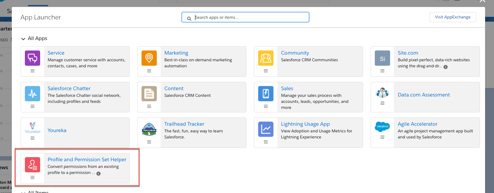
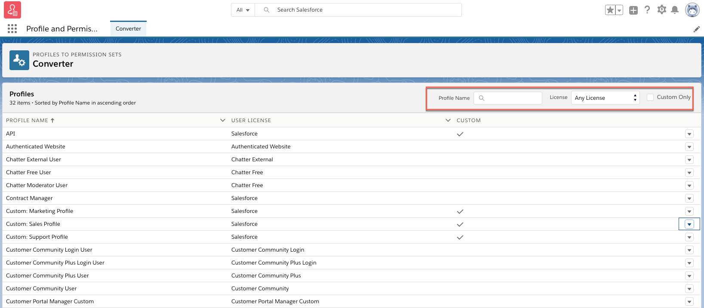
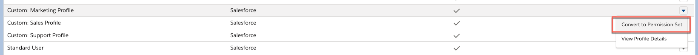
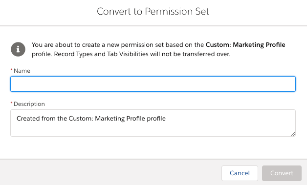
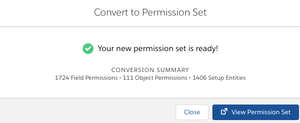

_\*The following article is for a tool that will only work in the Lightning Experience. If you use Classic, this is still relevant, you will just need to temporarily flip over.\*_

Maybe you have had that moment where you think that this profile would actually be much better as permission set. Maybe the profile has a limited number of items and really should be shared with specific people regardless of the profile that they have.

To give a more specific example, say you create a profile that only has permissions for an installed package. In actuality, you probably want those permissions to be a permission set, as those are easier to give to specific people and can provide additional permissions on top of their actual profile.

Until pretty much last month, if you had ever had this thought or something similar, you really had no options other than to go manually and create the permission set. Well, today that changes. Introducing from Salesforce Labs, the Profile and Permission Set Helper.

This tool is specifically designed to take your Profile and turn it into a flexible permission set. Keep reading to see how it works.

1. After you have installed the package from the [AppExchange](https://appexchange.salesforce.com/appxListingDetail?listingId=a0N3A00000FeF99UAF), click on the App Launcher to access the app 
2. Now you will see all of the profiles that you have. You can search or you can set to only show custom 
3. Once you have located the profile you are looking to convert, click the drop-down arrow on the right and select Convert to Permission Set 
4. You will be asked to give it a name, make sure it is something meaningful. You can also update the description 
5. Click Convert and enjoy a sip or two of tea while the app does its thing
6. Converted! You are all set and ready to use your newly and quickly created permission set 

Really it is as simple as that. I find generally that permission sets can be more flexible than profiles, given that they to go a person and can span across many different Profiles.
