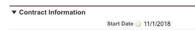
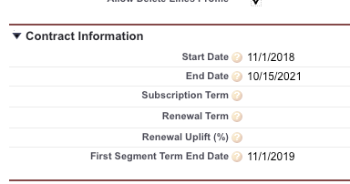
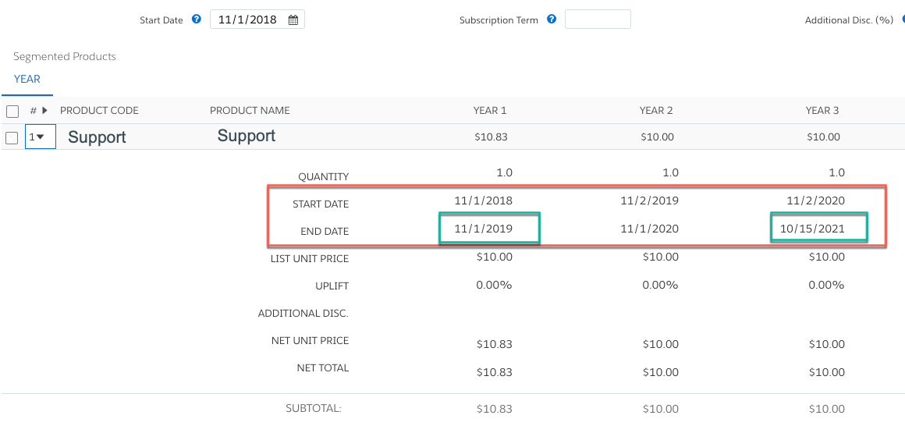

Like most folks who use CPQ to sell a product over several years (typically referenced as MDQ in the Salesforce world), you may have run into a scenario where the purchaser wants to end on a date that would not have you fall in a typical subscription month amount.

For example, say company ABC is buying a support package from you for the next 3 years. They want it to start in November 2018, with the first year ending in November 2019. However, they want the last year to end actually a month early, because of their fiscal calendar, and so they want the third year end date to be October 15th, 2021. In this scenario, you may be wondering what the best way to achieve this setup and which combination of the Start Date, End Date, Subscription Term, and First Segment Term End Date to use.

To have it start November 1st, 2018, you fill in the Start Date field on the Quote: 

Next, you will want to set the First Segment Term End Date to November 1st, 2019: 

Lastly, you will want to set the End Date to be October 15th, 2021: 

For the scenario we just went through you do not need, nor should you add the Subscription term. It will simply confuse the CPQ engine, as you should never fill out both the End Date and the Subscription together.

