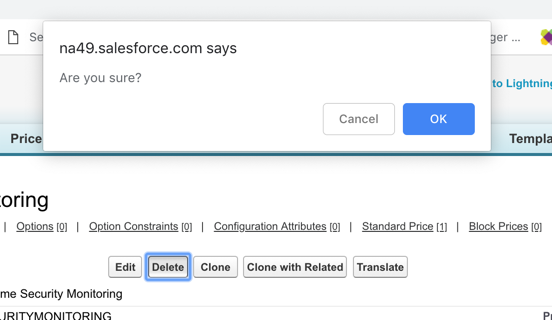
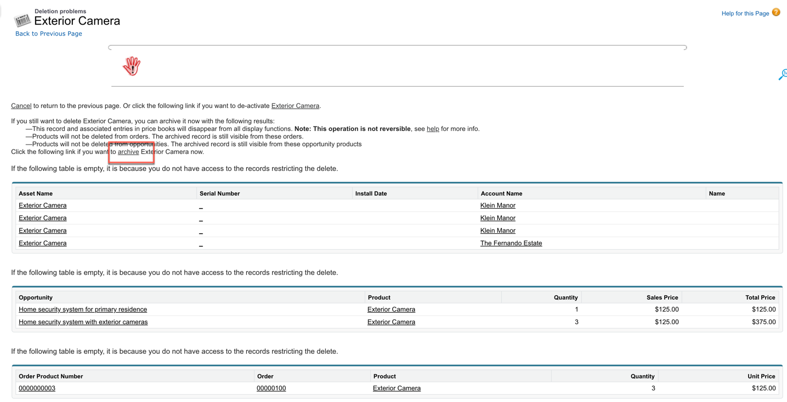

In the land of CPQ, or really just using Products in Salesforce in general, there is some hidden meaning to the Delete button on the Product record, that until recently I had not even heard of.

When clicking Delete on a Product record, one of two things is actually going to happen.

First, you will always get the "Are you sure you want to Delete" message: 

followed by either:

1. The Product actually moving to the recycle bin and eventually deleted from the system
2. The Product gives you a warning screen, telling you that the Product has been used in a Quote/ on an Opportunity and it, therefore, cannot be deleted, but rather Archived. 

Now, a normal reaction to Archive, would be great, the record is still there and I can retrieve it later if things change, but my previous usage of it won't be impacted. **DO NOT LISTEN TO YOUR INSTINCT HERE. IT IS WRONG!**

Archiving for a Product actually means you will get this message along the top:

And you will NEVER be able to use that Product record again. It also means, that while the Quotes and Opportunities that the Product is attached to is not visibly impacted, they are in fact impacted if you decide you want to close the Opportunity or Contract it or really take any further steps with the record that the Product was attached to. The only records that truly remain intact are records that will no longer be touched (i.e. closed a while ago and renewal was already created).

If you want to preserve the record for later use, the best course of action is actually to deactivate it. You can do this at two levels. You can do this at the Pricebook level - for example, if you have an old Pricebook that it is still relevant, but your new Pricebook no longer has the need for that Product. Or you can do this at the Product level. This does not actually deactivate the Pricebook record, but acts in the same way, but will work across the board and will no longer be accessible to anyone. If you then need the record again, you can simply reactivate it.

Overall, unless you created the Product by accident or just for testing, always use Deactivate, never use Archive.

P.S. Here is an idea board for allowing the [deletion of Archived Products](https://success.salesforce.com/ideaView?id=08730000000aeK0AAI)

For more information, you can check out the Salesforce documentation here: [https://help.salesforce.com/articleView?id=products\_del.htm&type=5](https://help.salesforce.com/articleView?id=products_del.htm&type=5).

**Studying for the CPQ Specialist Exam? Check SF9to5's** **[Study Guide](http://sf9to5.wordpress.com/2017/09/12/salesforce-cpq-exam-study-guide/)** **and** **[Practice Exam](http://sf9to5.wordpress.com/cpq-practice-questions/)**
