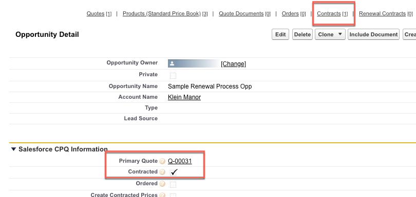
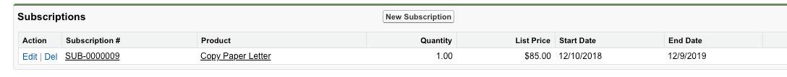
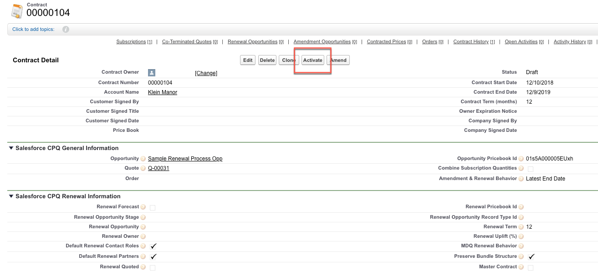
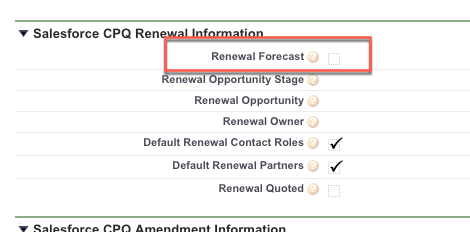
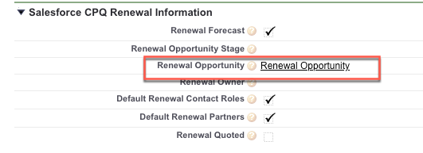

Recently I have come to understand that the process for generating a renewal opportunity using Steelbrick and the steps before and after it can be a bit confusing, if not cumbersome. In a hope to make the [documentation](https://help.salesforce.com/articleView?id=cpq_renewal_parent_new.htm&type=5) that Salesforce provides a bit more understandable, I am writing a two-part post detailing with images the standard out-of-the-box process that Steelbrick created.

_Anything that is automatically done by Salesforce I will call out, otherwise assume all steps to be manual steps. These steps are all out of the box without any customization._

So your opportunity has just closed won and it has a CPQ quote related to it and you want to know how to proceed with generating a Renewal Opportunity.

1. Close-Won your opportunity in the way that is compliant with your company's policy
2. Ensure that there is a CPQ quote related to the Opportunity and that it is the Primary Quote for the Opportunity
3. Click the Contracted checkbox to kickoff the renewal process
    1. NOTE: A Contract will only be generated if you have a Primary Quote and there are Subscription based Products on that Quote 
4. On the Contract, you will note that Subscriptions were automatically generated based on the Products and the setup for the Products 
5. Click the Activate button to "turn on" your Contract 
6. Click the Renewal Forecast checkbox - this will create the Renewal Opportunity automatically 
    1. By default, the name of the Renewal Opportunity will be just that "Renewal Opportunity 
    2. Before  viewing the Renewal Opportunity, it is advised to wait a couple of minutes as there is a bit of processing going on behind the scenes to get the Products setup correctly
7. You now have a Renewal Opportunity that can be amended and later can be Quoted. Please wait for Part 2 of this blog series to learn how to do this.
