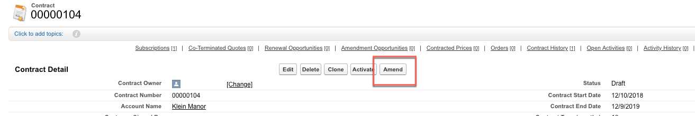
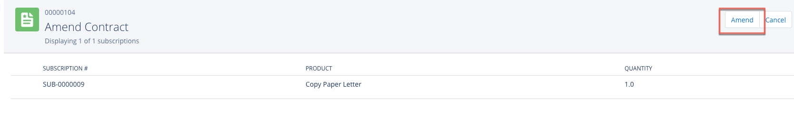
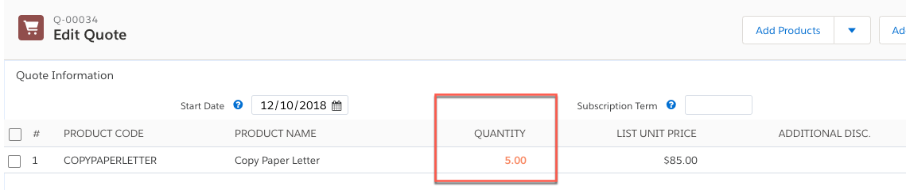
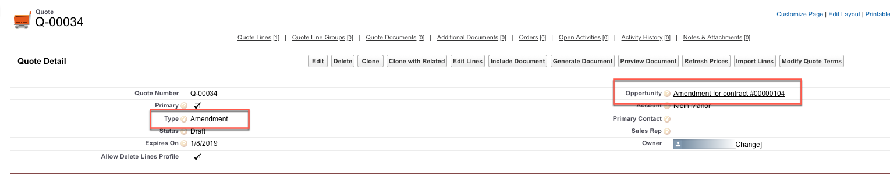
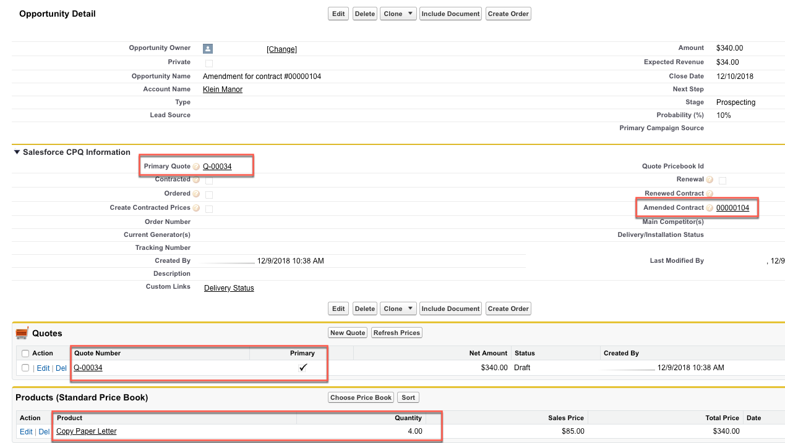
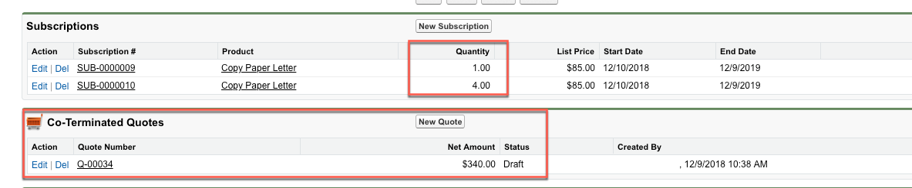
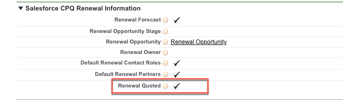
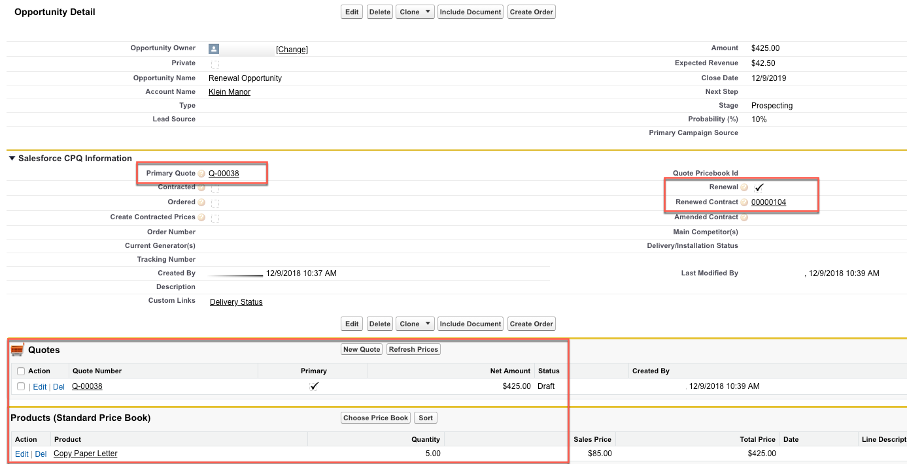

You have just learned how to create a Renewal Opportunity using the out-of-the-box functionality provided by Steelbrick. In this second part of the blog series, I am going to walk through the standard process for creating an Amendment and for generating the Renewal Quote, the last step in the process.

After your Renewal Opportunity is created, you may have different scenarios where you need to update the values (for example, increase the number of the product from 1 to 5) as part of the same Contract. The following steps will take you through that process.

_This is a simple example without any additional configuration. Please work with your CPQ partner to determine the best methodology and setup for your business use case._

1. From the Contract of the Opportunity that you want to update click the Amend button 
2. This will take you to a screen to see the Subscription products that can be amended 
    1. When you arrive at the Quote Line Editor(QLE) screen, however, you will see the entirety of the original quote.
3. On the QLE make the update, in this case, I am updating the Quantity from 1 to 5 and then click Save 
4. You will now be on the Quote object and can see that an Amendment Opportunity was automatically created for you 
5. For this information to sync back to the Contract, we started on, you will need to Close Won the Opportunity and click on the Contracted checkbox 
6. If you now go back to the original Contract (you may need to refresh), you will see an additional Subscription representing the additional products you added 

After enough time has passed for your business and you are done with all Amendments, the last step in the process is to generate the Renewal Quote.

1. From the Contract that we originally started with, click on the Renewal Quoted checkbox - this will automatically spin up a Quote on the Renewal Opportunity. 
    1. The Quote will be marked as Primary
    2. The Quote will contain any updates that had been made as a result of the Amendments that had been made during the interim
2. Finally, you will be able to see on the Renewal Opportunity the most up-to-date information about the products as well as the Quote. 

That's it! That's the standard out-of-the-box functionality. Of course, there is a lot of customization you can do along the way, so make sure to that in mind when you are building.
