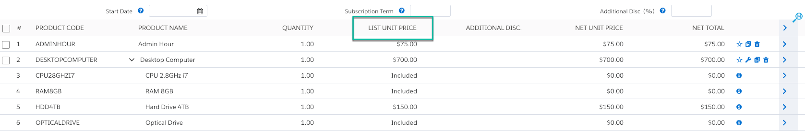
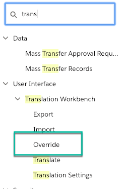
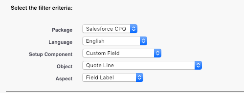
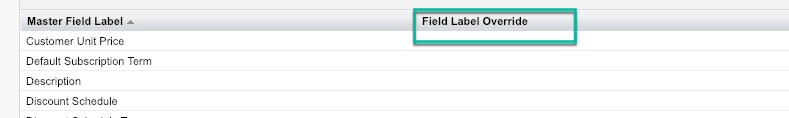
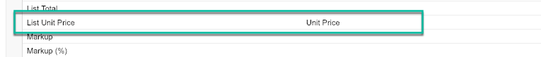
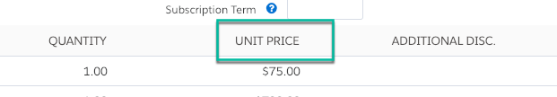

Have you ever looked at the Quote Line Editor and found that the labels being displayed didn't match your company lingo even though the values did? Well, here is a short and sweet trick for updating those labels - minimum effort required.

For my walkthrough of how to change the label, I am going to change the List Unit Price label in the QLE to Unit Price.

1. Go to Setup --> Translation
2. Click on Override 
3. Set your selections to match the image below (If you want to use this for other objects or other labels, just rearrange the settings to match what you are looking for): 
4. Update the Field Override on the List Unit Price to be Unit Price 
5. Refresh your quote and voila! 
