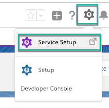
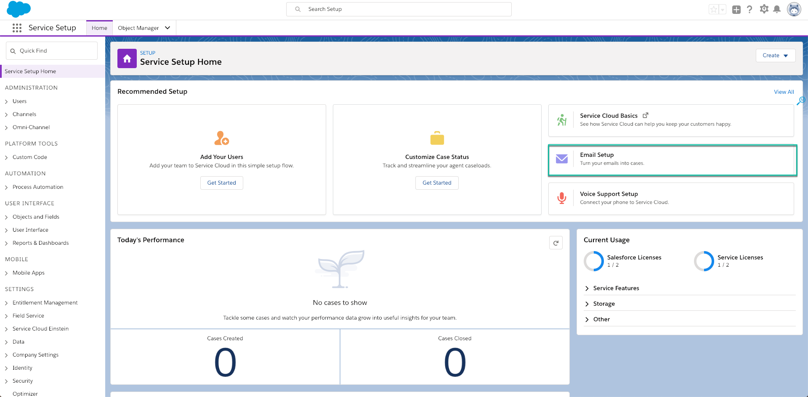

More than a year ago I wrote an article detailing [how to setup Email to Case for Gmail](http://sf9to5.wordpress.com/2017/08/02/how-to-setup-email-to-case-gmail/). That article was written specifically for Classic. Since that time many updates have been made on the Lightning side, including a Setup Walkthrough as part of the Service Cloud package for setting up Email to Case.

The use case for Email to Case can be varied, but typically it involves needing someone outside of your organization to send an email to Salesforce and have it be automatically turned into a Case. Below are the steps to do this in Lightning using the Setup guide.

1. Go to Service Setup 
2. Click on the Email Setup button 
3. Follow each of the guided steps. Images below contain extra info where relevant

\[gallery ids="2511,2510,2509,2508,2516,2506,2505,2504,2515,2514,2501,2500" type="slideshow"\]
