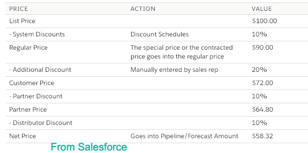

As part of the Salesforce CPQ (previously Steelbrick) package, there is a field on the Account level called Renewal Pricing Method. The purpose of this field maybe be confusing on the onset and so I want to provide some helpful guidance around using.

The Renewal Pricing Method field has three options:

1. Same
2. List
3. Uplift

If you do not choose anything for this field, then it will default its functionality to work as though you had chosen Same.

So what do these three options actually mean?

**Same** - This will take the same price, including discounts, from the original Opportunity and apply them to the Renewal Opportunity /Quote at the time of creating the Renewal. Meaning if you had a list price of 100 and then gave a 10% discount and it was sold for $90, then on Renewal Quote, you will see the same values flow through. Note that this discount is only on the customer price and does not take into account Partner or Distributor discounting.

**List** - This one pretty much does what you think it will do. It takes the List price of the Product based on the Pricebook in used in the Original Opportunity unless you have noted a Renewal Pricebook ID on the Contract, in which case it will take that List Price. There will be no flow through of Discounts if this option is selected.

**Uplift** - This is the only option that requires additional setup if you choose to use it. Uplift is for when you want to take your Customer price (see screenshot below for reference) and add some percentage of increase on the Renewal Quote. In addition to marking the field on the Account, you will need to set the Renewal Uplift Rate at either the Subscription or Contract level. If both are set, Subscription takes precedence over the Contract.

\[caption id="attachment\_2521" align="aligncenter" width="627"\] Pricing Waterfall\[/caption\]

Similarly, to the Same option, you will see the discounts flow through from the Original Opportunity and then the Uplift applied on top of that. The Additional Discount field will not be null when this is used and in some cases depending on the original Discount can result in negative values in the Discount field to account for the Uplift.

There you have it! Hopefully, that sheds some more light on what the Renewal Pricing Method field means.
