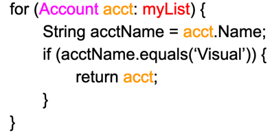
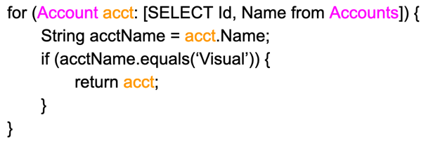
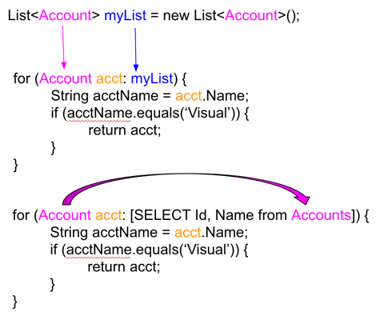
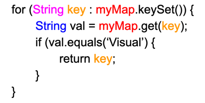
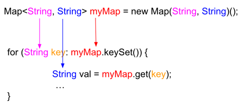
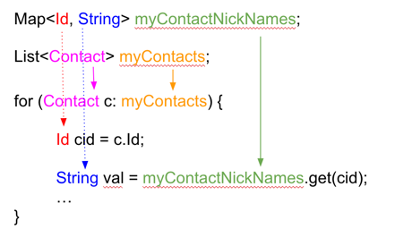

Growing from a [Salesforce Admin to a DevAdmin](http://sf9to5.wordpress.com/2018/08/26/journey-salesforce-dev-admin/) entailed getting familiar with APEX and doing exercises that simulated real-world business problems. To get a better grasp of APEX, I asked a friend to help me design a customized curriculum and come up with practice questions. On a side note, although there are many resources out there that teach you APEX the standard way (think CS101 in school), learning a new programming language and its gotchas with an experienced software engineer would tremendously help build your skills.

During our teaching sessions, my friend noticed that I had some difficulties in understanding two topics: JSON parsing (if you’ve done it in APEX, you know how convoluted it is) and anything that involved iterations over Maps and Lists. For the former, he provided a very easy method to [dissect the JSON document into its corresponding APEX types](http://sf9to5.wordpress.com/2018/05/10/parse-json-apex/). 

To help me with the latter, he showed me a cool way to visualize how the different variables and types are connected. This technique proved useful when I had to add/modify other people's code.

Let’s start with defining a variable of type List which stores Accounts (this is the Salesforce Account Object).

**List<Account\> myList = new List<Account\>();**

Let’s iterate over the list to find the Account with the Name equal to “Visual”.

In the same context, a slightly more “advanced” example:

Now, let’s create the color map for the examples above:

For the second example, let’s define a variable of type Map where the key is of type String and the value is of type String as well.

**Map<String, String\> myMap = new Map <String, String\> ();**

Let’s iterate over the map and find the key for which the value is equal to “Visual”:

Now, let’s put together a color map for Maps:

Finally, now that I have shown a color map for Lists and Maps, let’s create a color map for when you need to use both Maps and Lists.

Over time, with more experience, it will become more natural to you, but if you’re just starting out with APEX development, I hope that this method will help to get a more solid understanding of how to iterate over maps and lists and will prevent you from doing silly bugs like I did  :)
