As part of the Service Cloud and the Service Console, you can provide your users access to Macros. Macros are like little robots that take over the items that you do repeatedly on a daily basis. An example of something that makes a good Macro is sending an email that already has a template and the user doesn't need to make any modifications to it.

Building a Macro doesn't require much more than the clicks you would do to send the actual email.

Here is how you can create a Macro that will auto send an email with just a click of a button.

Pre-Reqs:

1. You need Service Cloud licenses
2. You need to be using the Service Console

Steps:

1. Click on the Macros tab in the bottom left-hand corner from the object that you want to be creating the Macro for. 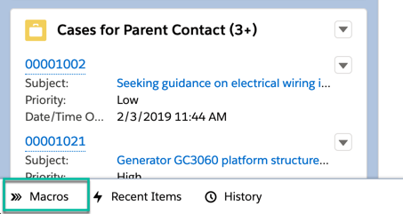
    1. If you do not see the Macros option you will need to update the App (post coming soon on how to do this)
2. Then click the + in the right-hand corner of the pop-up window 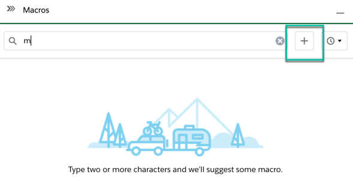
3. Give the Macro a name and a description - remember that this name should be easy for your reps to understand what it is for. You will also need to select the object that this is applied to. In my case, I am going to be using the Case object. 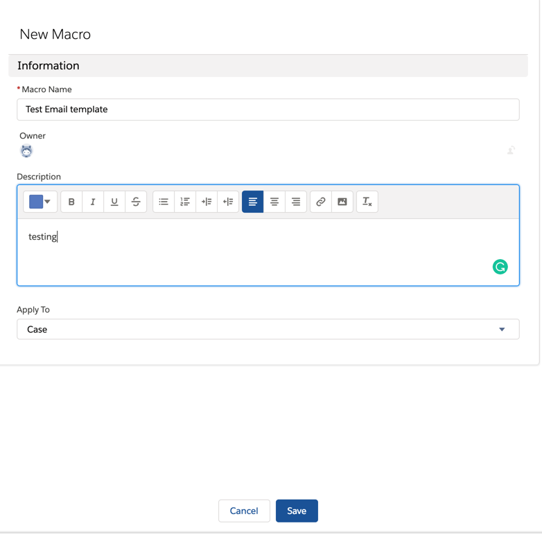
4. Click Edit Instruction in the top right-hand corner 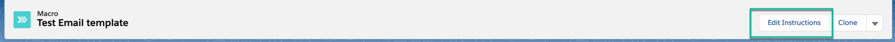
5. Here you are going to be presented with a copy of what your page actually looks like to the user. The purpose is to make it easy for you to know how to give the system the instructions.
6. On the right click the Add instruction. You will then see that some items on the page outline in Blue including the Email button in the Feed. Click on the Email button to proceed. 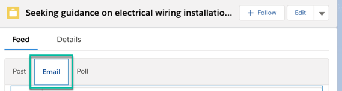
7. From here you could manually fill out the sections, but I am going to demonstrate with a pre-built email template. So on the right side, you will see a box now to select the email template. 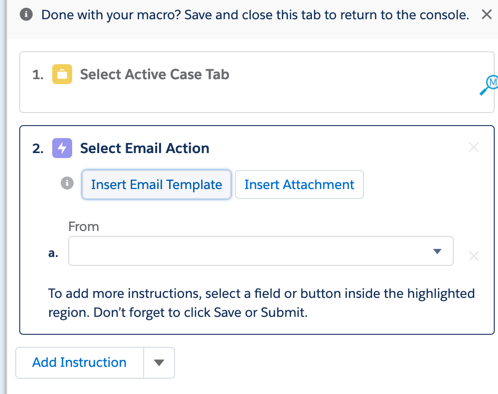
8. From here you will pick the relevant template. Once you do so additional options will appear in the sidebar. 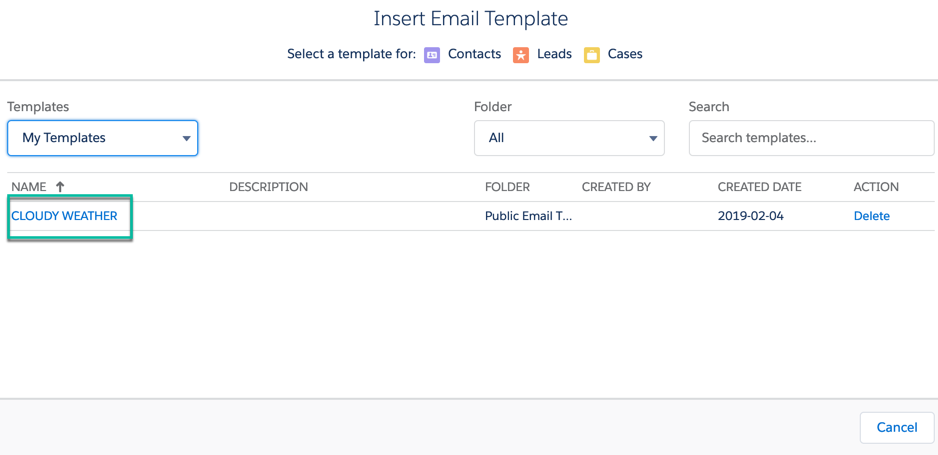
9. You can manipulate who it sends From based on your available org-wide addresses. You can also tell the system where/how to replace any relevant text - I typically go with replacing existing text.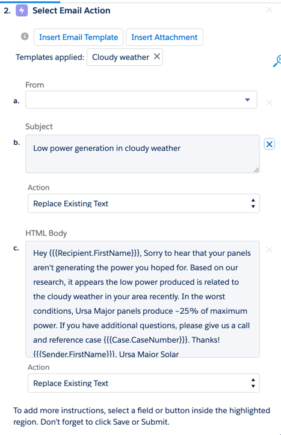
10. Now we need to add instructions to actually Send the email.
     1. Keep in mind this step is optional. Maybe you need reps to be able to make edits to the email before it is sent - you are still saving them clicks with this route. 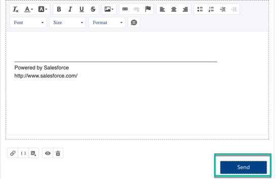
11. Click the Send button on the main screen section. This adds it to the side panel with a warning, that once this is done and cannot be undone, which when you think about it makes sense, there is no recalling of emails. 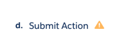
12. Unless you have more you would like to add to this Macro, you are all set to click Save and close the tab. 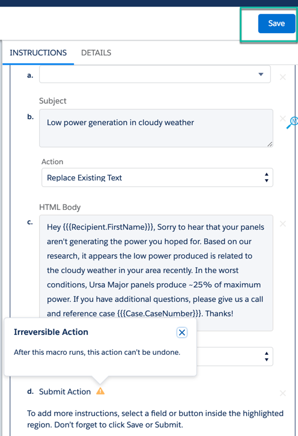
13. Now if you go back to your Case you can test your Macro out. \[gallery ids="2572,2571,2569" type="columns"\]

 

And that's it! And because it can be tricky to locate where you edit the Macro you just made; in the bottom corner when you click on the Macro there is an Edit link, click that and it will take you the relevant record where you can edit the properties or the Macro itself. 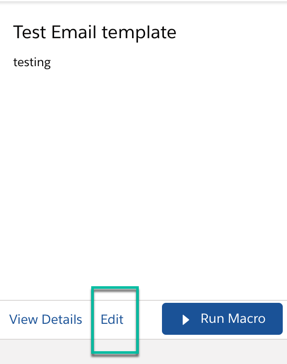
